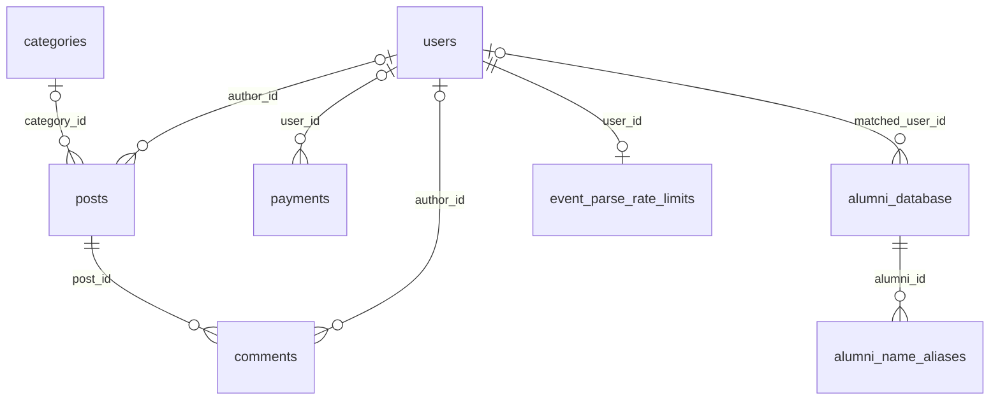
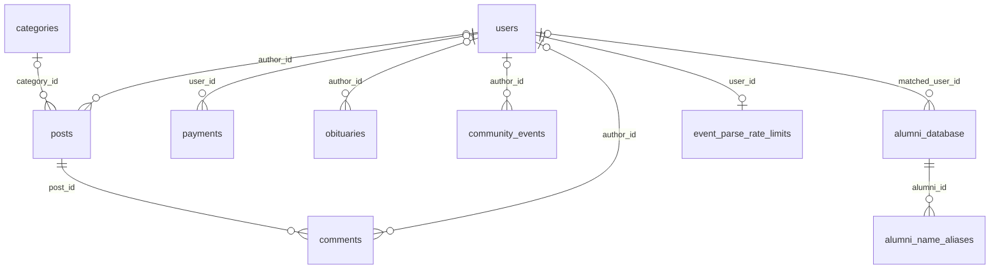
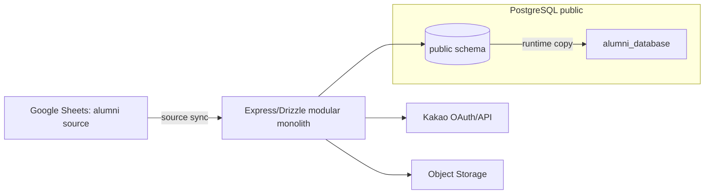

# DB 구조 변경·catalog 이력（2026-11-09까지）

> 이력 보관본: `main d7184ca`에 있던 문서를 보존했다. 본문 속 “현재”, “최신”, “이번”, 승인·보류 및 명령은 각 작업 당시의 설명이며 현재 상태나 실행 지시가 아니다.
> 현행 기준은 [docs/database-schema.md](../database-schema.md)을 따른다. 이 문서를 근거로 완료된 SQL·배포·시험을 다시 실행하지 않는다. 문서 이동은 DB나 운영 환경의 재검증을 뜻하지 않는다.

# 데이터베이스 스키마 기준서

이 문서는 행 데이터, 연결 문자열, 사용자·호스트명, Secret을 포함하지 않는 `public` 메타데이터 기준서다. Development의 최신 전체 관찰은 2026-11-09 20:09 KST, Production은 20:30 KST 가리기 컬럼 추가 후 catalog이며 모두 13개 테이블·103개 컬럼이다. 운영 컬럼 적용 전후 상태를 구분해 아래에 기록한다.

### 게시글 관리 추가 계약 (2026-11-09)

- 후속 릴리스에서 같은 `is_hidden` 컬럼의 Production 적용을 승인받았다. 운영 적용 전후 metadata-only catalog와 기존 행 보존을 새 연결로 확인하며, 아래 개발 결과와 실제 운영 적용 결과를 구분한다. 운영 구조 변경은 컬럼 하나로 한정한다.
- 확정된 개발 추가 구조는 `posts.is_hidden boolean NOT NULL DEFAULT false` 하나다. 기존 `is_published`는 초안/게시 구분으로 유지하며 가리기에 재사용하지 않는다. 기존 행은 false로 유지하고 본문·사실 JSON·댓글·작성자·최초 게시 시각을 바꾸지 않는다. 새 테이블·제약·인덱스·RLS·트리거는 추가하지 않는다.
- 기존 `revision`으로 일반 글 수정·작성자 삭제·관리자 가리기/다시 표시하기의 충돌을 검사한다. 작성자 수정·삭제는 SQL에도 `author_id`, `is_published`, `revision` 조건을 적용한다. 가리기 권한은 서버가 현재 회원의 관리자 여부로 판단한다.
- 정상 목록·검색은 게시됨 + 가리지 않음 조건이다. 가린 글 상세·관리 목록은 작성자/관리자만 볼 수 있고 댓글 추가는 막는다. 댓글의 기존 ON DELETE CASCADE를 사용해 작성자 삭제 시 댓글을 함께 제거하며 Object Storage 파일은 삭제하지 않는다.
- 경조사 수정은 기존 `event_data`·본문을 한 번에 반영하고 `source_text`는 NULL로 유지한다. 정정 미리보기는 15분 유효한 서버 서명 응답으로만 전달하며 DB에 별도 사본을 저장하지 않는다. 작성자·대상 ID·revision을 묶어 다른 글/회원의 미리보기 재사용과 임의 사실·본문 조작을 막는다. 현재 사실 JSON의 물리 계약은 바꾸지 않는다.
- 2026-11-09 20:09:49 KST `heliumdb`에 컬럼 추가를 COMMIT하고 새 연결에서 위 타입·기본값·NOT NULL을 확인했다. posts 0건이며 전체 테이블 건수와 기존 본문 JSONB 구조를 보존했다. 기존 행이 있는 상태의 가리기·수정·삭제 기능을 실행한 결과는 아니다.
- 같은 시각 metadata-only catalog는 tables/columns/PK/FK/non-PK UNIQUE/CHECK/indexes/sequences `13/103/13/8/6/7/24/9`다. READ ONLY gate·ROLLBACK·완료 marker를 확인했고 차이는 `posts.is_hidden` 컬럼 한 개뿐이다. view·trigger·policy·routine·enum·domain 0개, RLS 모두 비활성을 유지한다.
- catalog SHA-256은 `453a1924708cc258dec6385be2f461753813747d8ee2a7226f63dd47c2c11e5a`, schema snapshot은 `f6b63b83be2de88e510c88cf6a010987bd67ef2f8d09dfa2e569adbb0f6095fb`다. Replit `.superpowers/post-management-20261109/development-after-catalog.txt`·`development-after.json`·`development-after-schema.sql`을 근거로 한다. 이 개발 단계에서는 운영 DB를 조회·변경하지 않았다.
- 운영 릴리스 사전 조회: 20:25:34 KST `neondb`·PostgreSQL 16.15·READ ONLY에서 `13/102/13/8/6/7/24/9`를 확인했다. 본문 JSONB NOT NULL·문서 CHECK는 유지되고 `is_hidden`은 없다. catalog SHA-256 `20a089c1f0b4cfb8bf9fc98d2277c6fd0b6de99ebe451b1690abece58e2e5460`, schema snapshot SHA-256 `ba5949b53db20876b8568748e8ab5bdec5718cbc5eb8ba43dbd8b93201bc15d9`이며 `.superpowers/post-management-release-20261109/production-before*`에 보존했다.
- 운영 적용 결과: 20:30:31 KST `neondb`에 `posts.is_hidden boolean NOT NULL DEFAULT false`를 추가했다. 20:30:35 KST 새 READ ONLY 연결의 catalog는 `13/103/13/8/6/7/24/9`이며 유일한 차이는 새 컬럼이다. 나머지 객체·RLS·본문 JSONB 문서 CHECK는 동일하다. 기존 게시글 3건은 모두 false이고 기존 값의 digest와 전체 테이블 건수를 보존했다.
- 운영 적용 후 catalog SHA-256 `27588cbda434da037691dbf79f754ed8956b5b01fdc082a83227f3479eed8262`, schema snapshot SHA-256 `b47524e4018d022f86803465aa4adf62bbe7495843368b3d5fb8fe98cf6be15f`다. `.superpowers/post-management-release-20261109/production-after.json`·`production-after-catalog.txt`·`production-after-schema.sql`에 대상·READ ONLY gate·ROLLBACK·완료 marker와 차이를 기록했다.

### 운영 릴리스 구조 (2026-11-09)

- 운영 `neondb`는 posts 통합 구조·수집 규칙을 포함한 13-table 최종 구조다. 아래 12:56 기록은 구 테이블을 유지했던 15-table 중간 상태이며 실제 삭제는 [웹 게시 절차](database-operations-2026-11-09.md#웹-게시의-구-테이블-제거-절차)로 마쳤다.
- 12:56 KST `scripts/release-posts-additive.sql`을 커밋했다. 아래 개발 계약과 같은 posts 컬럼 4개·CHECK 2개·partial UNIQUE 1개, `source_collection_rules`의 8개 컬럼·PK·UNIQUE·CHECK 2개·시퀀스를 추가했다. 카테고리 seed는 구조 변경과 구분해 5→7건으로 확인했고 기존 나머지 테이블 건수는 보존했다.
- `scripts/release-posts-cleanup.sql`은 준비한 수동 제거 경로이며 실행하지 않았다. 사용자가 승인한 두 빈 테이블 삭제는 Replit이 검토 화면에 제시한 두 문장의 마이그레이션으로 적용됐다. 일반 테이블이나 다른 객체 삭제로 범위를 확대하지 않았으며 [운영 완료 결과](database-operations-2026-11-09.md#운영-전환-완료-결과)를 따른다.
- 12:43 KST 적용 전 catalog는 `14/119/14/10/6/2/24/10`이었다. 출력 SHA-256은 `45ed6417e03fdd8c6ade05ea72aac7b5fec226932c91c20d88ba2b70b947bec1`이며 Replit `.superpowers/release-20261109/production-before-catalog.txt`에 보존한 이력이다.
- 12:56 KST 추가 구조 적용 직후 catalog는 tables/columns/PK/FK/non-PK UNIQUE/CHECK/indexes/sequences = `15/131/15/10/7/6/27/11`이었다. view·trigger·policy·routine·enum·domain은 0개이며 모든 public 테이블의 RLS는 비활성이었다. 새 연결에서 `neondb`·READ ONLY gate·ROLLBACK·`__CATALOG_INSPECTION_COMPLETE__`를 확인했다. 출력 SHA-256은 `1883ff1b398b00a56d58914c245cf7569d2aca87cf516b6e2dd60b692f40879a`이며 `.superpowers/release-20261109/production-after-additive-catalog.txt`에 있다. 당시에는 Republish와 구 테이블 제거 전이었다.
- 13:18 KST 웹 삭제 승인 직전, 두 구 테이블과 행 타입의 의존 객체를 추가로 확인했다. 외부 incoming FK는 없고 `pg_depend` 결과는 테이블 소유·내부 객체(`a`·`i`)뿐이다. 이 확인은 전체 catalog 재수집이 아니며, Replit 생성 SQL 두 문장의 실효 삭제 범위가 승인한 두 테이블·소유 객체를 넘지 않는다는 근거다. 실제 삭제 후 전체 catalog를 별도로 기록한다.
- 13:25 KST 최종 catalog는 `13/102/13/8/6/6/24/9`이며 view·trigger·policy·routine·enum·domain은 0개, RLS는 모두 비활성이다. 대상 `neondb`·READ ONLY gate·ROLLBACK·완료 marker를 확인했다. 추가 구조 적용 후 catalog와 비교한 차이는 두 구 테이블의 컬럼·제약·인덱스·소유 시퀀스 제거뿐이며 존속 객체의 변경·추가 누락은 없었다.
- 최종 SQL digest는 `7263c0736c96cbb3120252778b7adf8a463700ece8cd59b57be99cdb5fad757f`, 출력 digest는 `50b2f6f8676b7ad37a6a1ebd15e596255450f5db5c23f8a1430c6a4cfbf3c60c`다. 근거 파일은 Replit `.superpowers/release-20261109/production-after-web-publish-catalog.txt`이며 당시 개발 구조와 일치했다. 그 시점에는 본문 JSONB 전환 전이었으며 후속 운영 전환은 아래 결과를 따른다. 과거 표의 Production 미적용 표시는 해당 작업 시점의 이력이다.

### 공개 링크 수집 규칙 (2026-11-09 개발 적용)

- 새 전용 테이블 `source_collection_rules`는 게시글·명부·회원과 FK로 연결하지 않는다. 소유자는 경조사 수집 모듈이며 앱 서버만 조회·갱신한다. 브라우저에는 DB 접속정보를 주지 않는다.
- 컬럼: `id serial PRIMARY KEY`, `domain text NOT NULL`, `page_pattern text NOT NULL`, `rule jsonb NOT NULL`, `version integer NOT NULL DEFAULT 1`, `created_at timestamptz NOT NULL DEFAULT now()`, `updated_at timestamptz NOT NULL DEFAULT now()`, `last_success_at timestamptz NOT NULL`.
- 제약: `(domain, page_pattern)` UNIQUE, version 양수, rule은 object이며 `schemaVersion=1`. PK와 unique btree index, serial sequence를 사용한다. 새 FK·trigger·routine·RLS 정책은 만들지 않는다.
- JSON 계약: 적용 도메인·페이지 주소 패턴, API 주소 템플릿·HTTP 메서드, URL에서 ID를 얻는 방법과 허용된 변환, 응답 경로별 공통 사실 매핑·구조 조건을 기록한다. 임의 실행 코드·개별 원문·ID 실값·개인정보·쿠키·토큰은 허용하지 않는다. 구조와 실제 사실 수집을 확인한 규칙만 upsert하며 성공 시각을 갱신한다.
- 기존 `posts.event_data` JSON에는 선택적인 필드별 출처를 추가한다. 기존 JSON과 호환되며 물리 컬럼 변경은 없다. 원문 값은 처리 메모리에서만 사용하고 규칙 테이블에 넣지 않는다.
- additive SQL `scripts/add-source-collection-rules.sql`을 05:04 KST 개발 DB에만 적용했다. 기존 12개 테이블과 명부 3,458건을 보존했다. 아래 표는 그 시점의 관찰이며 최신 본문 컬럼·CHECK는 본문 JSONB 계약과 개발 catalog를 따른다.

| 수집 규칙 추가 당시 Development catalog | 2026-11-09 05:04 KST |
|---|---|
| 대상 | `heliumdb`, PostgreSQL 16.10, `public`, READ ONLY |
| tables / columns | 13 / 102 |
| PK / FK / non-PK UNIQUE / CHECK | 13 / 8 / 6 / 6 |
| indexes / sequences | 24 / 9 |
| views / triggers / policies / routines / enums / domains | 모두 0 |
| RLS | 모든 public 테이블 비활성, 새 정책 없음 |
| 코드 대응 | 12개 `pgTable` + runtime `session` |

- 이전 통합 테이블 12개에 `source_collection_rules`만 추가했다. 새 8개 컬럼은 모두 NOT NULL이며 id는 `source_collection_rules_id_seq`, version은 1, created_at/updated_at은 now()를 기본값으로 쓴다. last_success_at에는 기본값을 두지 않고 성공한 수집에서 앱이 설정한다.
- 제약 이름은 `source_collection_rules_pkey`, `source_collection_rules_domain_pattern_unique`, `source_collection_rules_version_check`, `source_collection_rules_json_check`다. 모두 validated이고 PK/UNIQUE의 btree index는 valid·ready다. 삭제·참조 동작, FK·trigger·routine 추가는 없다.
- JSONB는 `schemaVersion`, `domain`, `pagePattern`, `id.source/key/transform`, `request.method/urlTemplate`, `fields[].field/path`, `shape[].path/type`를 가진다. 앱은 strict schema와 허용 필드·공개 주소를 검사한다. 현재 GET 및 identity/base64url 변환만 지원하며 실제 개인정보 값과 ID는 template/path에 저장하지 않는다. 동일 `(domain,page_pattern)` upsert 시 version+1, updated_at/last_success_at을 갱신하고 재사용 성공은 last_success_at만 갱신한다.
- catalog SQL digest는 기존 `7263c0736c96cbb3120252778b7adf8a463700ece8cd59b57be99cdb5fad757f`, 이번 출력 digest는 `5d5fa59ebd65c7e344bff3e245cd1dbf8f0ca28749a64b64963cd85307c5693b`다. Replit `.superpowers/collector-20261109/after-catalog.txt`의 gate·ROLLBACK·completion marker를 확인했다. 자세한 적용·보존 기록은 [운영 런북](database-operations-2026-11-09.md#적용-기록)을 따른다.

### 경사 수집 JSON 계약 확장 (2026-11-09)

- `source_collection_rules.rule`의 schemaVersion은 1을 유지하고 선택 키 `noticeTypes`에 `obituary|wedding|opening` 지원 유형을 저장한다. 키가 없는 직전 규칙은 읽기 시 부고 전용으로 해석하며 행을 일괄 갱신하지 않는다. 새 규칙은 실제 추출한 유형을 기록하고 해당 유형의 필수 근거·응답 구조를 충족할 때만 저장·재사용한다.
- 필드 매핑에 신랑·신부, 양측 부모, 결혼 관계, 예식 장소·주소, 식사·주차·화환 안내와 개원 일시·한의원명을 구분한다. 회원 신원·등급·등록 권한은 규칙이나 외부 응답으로 판정하지 않는다. 기존 응답 경로·타입 조건·ID 템플릿·민감 값 미저장 계약을 유지한다.
- URL 식별자는 기존 숫자/긴 opaque ID 선택을 우선하고 없으면 영문·숫자·`_`·`-`의 3~100자 청첩장 slug를 허용한다. `invitationId`, `cardId`, `uid` query도 지원한다. API에서 같은 식별자로 확인한 경우만 `{id}`로 치환하며 개별 값은 저장하지 않는다. 익명 GET 재조회·응답 구조·유형별 사실 조건과 공개 주소 제한을 계속 적용한다.
- `posts.event_data.facts`에는 선택적인 `groomName`, `brideName`, `weddingPartyRole`, `childAdmissionYear`, `childGraduationClass`, `address`, `meal`, `parking`, `flowerPolicy`를 추가한다. 기존 JSON의 키 누락은 허용한다. `childAlumniInfo`와 `childMemberType`은 호환 입력으로만 두며 자녀 표시명·학번·졸업기수·회원 호칭은 서버 명부에서 다시 확인한다.
- 물리 컬럼·제약·인덱스·시퀀스·FK·RLS·runtime DDL은 바꾸지 않는다. 새 테이블이나 JSON 데이터 마이그레이션이 필요하지 않으며 05:04 catalog는 직전 물리 구조 관찰 이력으로 유지한다.
- 적용 상태: 2026-11-09 Replit 개발 코드에 계약 확장을 반영하고 타입·경계 검사를 통과했다. 이번 읽기 전용 확인에서 `heliumdb`의 기존 규칙은 1개이고 `noticeTypes` 보유 행은 0개였다. 전체 catalog를 다시 수집하지 않았으며 새 경사 규칙의 실제 저장·재사용은 실행하지 않았다.

### 게시글 본문 Tiptap JSONB 계약 (2026-11-09)

- 확정된 목표 구조는 `posts.content jsonb NOT NULL`이며 기본값은 두지 않는다. 값은 표준 `{ "type": "doc", "content": [...] }` 문서다. 기존 컬럼을 전환하며 별도 HTML·Markdown 원본 컬럼이나 형식 플래그를 만들지 않는다. 아래 TEXT 기록은 이전 릴리스 이력이다.
- `posts_content_document_check`는 JSON object·`type=doc`·content array를 `IS TRUE`로 확인한다. 세부 노드 구조·허용 속성·문서 크기·안전 링크는 공통 Tiptap 스키마와 서버 입력 계약으로 확인한다. 새 테이블·시퀀스·인덱스·FK·RLS·trigger·routine은 추가하지 않는다.
- 지원 노드: doc, paragraph, text, heading(H1~H4), hardBreak, blockquote, codeBlock, horizontalRule, bulletList, orderedList, listItem. 마크: bold, italic, strike, underline, code, link. 외부 이미지·임의 HTML 노드·실행 가능한 속성은 허용하지 않는다.
- API의 본문도 JSON 문서다. 기존 `posts.event_data`는 경조사 사실 정보로 유지하고 문안 JSON과 합치지 않는다. 경조사 writer의 문자열 결과는 문서로 변환해 저장하며 게시 직전 같은 문서 스키마로 재생성 비교한다. 빈 초안은 빈 paragraph 문서로 표현한다.
- 목록 요약·검색용 일반 텍스트는 본문에서 파생한다. 검색은 JSON 속성명·링크 속성 대신 text 노드와 본문 줄 경계를 읽고 제목과 함께 찾는다. 별도 검색 텍스트를 편집 가능한 원본으로 두지 않는다.
- 기존 본문은 [개발 전환 런북](database-operations-2026-11-09.md#본문-jsonb-개발-전환-2026-11-09)과 후속 승인된 [운영 전환 런북](database-operations-2026-11-09.md#본문-jsonb-운영-릴리스-2026-11-09)에 따라 보존·변환했다. 두 환경의 실제 적용과 catalog는 아래 기록을 따른다.

#### 본문 JSONB 개발 catalog와 적용 결과

- 2026-11-09 19:06:32 KST `heliumdb`에 전환을 COMMIT했다. 전환 전 posts는 0건이므로 변환·오류도 각각 0건이다. 새 연결에서 JSONB·NOT NULL·기본값 없음과 `posts_content_document_check` validated를 확인했다. 내용이 있는 게시글의 변환 성공으로 확대하지 않는다.
- 19:07:21 KST 전체 metadata-only catalog의 대상·READ ONLY gate·ROLLBACK·완료 marker를 확인했다. tables/columns/PK/FK/non-PK UNIQUE/CHECK/indexes/sequences는 `13/102/13/8/6/7/24/9`이며 view·trigger·policy·routine·enum·domain은 0개, RLS는 모두 비활성이다.
- 직전 catalog와의 차이는 `posts.content`의 TEXT→JSONB 및 이에 따른 collation 제거, CHECK 1개 추가뿐이다. 컬럼 순서·NULL·기본값·다른 객체는 같다. `event_data`·`source_text`·첨부·댓글과 수집 규칙 구조는 변경하지 않았다.
- catalog SQL SHA-256은 `7263c0736c96cbb3120252778b7adf8a463700ece8cd59b57be99cdb5fad757f`, 결과 SHA-256은 `d302d047af9bcea90ec1f834617ac40cffe4de99f5595bc0fbc4938867ce1b3b`다. Replit `.superpowers/post-body-jsonb-20261109/after-catalog.txt`·`catalog-receipt.json`을 근거로 한다.

#### 본문 JSONB 운영 전환 범위

- 2026-11-09 후속 승인으로 Production `neondb.posts.content`에도 위 JSONB NOT NULL·CHECK 계약을 적용한다. 운영 전용 `scripts/migrate-post-body-production.ts`가 기존 변환 로직과 별도의 대상 제한 DDL `scripts/post-body-jsonb-production.sql`을 사용한다. 일반 개발 연결과 개발 SQL의 대상 제한은 유지한다.
- 운영 기존 본문을 보존해 변환하고 본문 외 컬럼·`event_data`·첨부·댓글·명부·회원·수집 규칙을 유지한다. 신규 테이블·컬럼·인덱스·함수·RLS는 추가하지 않는다. 실행 전후 metadata-only catalog와 실제 적용 기록은 [운영 런북](database-operations-2026-11-09.md#본문-jsonb-운영-릴리스-2026-11-09)을 따른다.
- 19:32:22 KST 전환 전 `neondb`·READ ONLY·PostgreSQL 16.15를 확인했다. catalog는 `13/102/13/8/6/6/24/9`, 출력 SHA-256은 `50b2f6f8676b7ad37a6a1ebd15e596255450f5db5c23f8a1430c6a4cfbf3c60c`로 직전 운영 구조와 같다. `content` TEXT NOT NULL·기본값 없음, 해당 컬럼 의존 객체 0개이며 새 본문 CHECK는 아직 없다. Replit `production-before-catalog.txt`에 보존했다.

#### 본문 JSONB 운영 catalog와 적용 결과

- 2026-11-09 19:41:21 KST `neondb`에서 전환을 COMMIT했다. 원본 보존 후 본문 3건을 변환했으며 오류 0건이다. 새 연결에서 문서 3건·본문 외 모든 필드·검색 텍스트 3건과 전체 테이블 건수 일치를 확인했다.
- 19:41:38 KST metadata-only catalog는 `13/102/13/8/6/7/24/9`이며 READ ONLY gate·ROLLBACK·완료 marker를 확인했다. `content` JSONB NOT NULL·기본값 없음, `posts_content_document_check` validated다. 전후 객체 차이는 본문 타입·collation과 CHECK 1개뿐이다. view·trigger·policy·routine·enum·domain은 0개이고 RLS는 모두 비활성이다.
- 결과 SHA-256은 `20a089c1f0b4cfb8bf9fc98d2277c6fd0b6de99ebe451b1690abece58e2e5460`, schema snapshot SHA-256은 `f03e346396da876ff6b362a46740bd0df0711b21de98ac9c7ea4c85e3febd663`다. Replit `.superpowers/post-body-jsonb-release-20261109/production-after-catalog.txt`·`production-after.json`·`production-after-schema.sql`과 [DB 실행 기록](database-operations-2026-11-09.md#본문-운영-전환-결과)에 보존했다.

### 이전 게시글 본문 표현 계약 (2026-11-09 이력)

- `posts.content`의 물리 타입은 기존 TEXT를 유지한다. 일반 글 서식 편집기의 저장 값은 마크다운이며 지원 서식은 굵게·기울임·취소선·번호/글머리기호 목록·링크·H1~H4다. HTML 붙여넣기는 편집기에서 지원 서식으로 변환한다.
- 기존 일반 텍스트·경조사 정적 생성 본문도 공통 표시기로 읽는다. 기존 행을 다시 쓰거나 별도 HTML/JSON 본문 컬럼·형식 플래그를 추가하지 않는다. 입력 HTML의 스크립트·임의 속성·외부 삽입 콘텐츠는 본문 실행 대상으로 삼지 않는다.
- API의 `content: string`, 회원 전용 접근과 경조사 구조화 사실·게시 전 재생성 비교는 유지한다. DDL·migration·catalog 변경은 없다.
- 2026-11-09 Replit 개발 코드에 입력·표시 계약을 적용하고 타입·경계 정적 검사를 통과했다. 이번에는 DB에 연결하지 않았으며 실제 게시글 저장·조회 시험이나 catalog 재수집을 수행하지 않았다.

### 게시글 통합 구조 (2026-11-09)

최초 개발 전환 이력은 **코드 구현·Development 스키마 적용**이다. [제품 정책](../../planning_proposal.md#게시글과-경조사-통합)에 따라 2026-11-09 03:17:22 KST에 `scripts/unify-posts.sql`을 커밋했다. 03:21 KST 새 연결의 metadata-only catalog는 read-only gate·ROLLBACK·completion marker로 종료됐고 아래 개발 구조를 확인했다. 전환 SQL은 재실행하지 않는다. 당시 Production은 조회하지 않았으며 이후 운영 추가 구조 적용은 위 최신 기록을 따른다.

- 모든 게시물과 경조사 초안은 `posts`를 사용하고 분류는 `categories`를 사용한다. `community_events`·`obituaries`는 통합 코드와 Development에서 삭제했으며 별도 경조사 상세 테이블로 대체하지 않는다.
- 기존 공지·자유·행사·소식에 `부고`·`경사` 카테고리를 추가한다. `경사` JSON의 유형은 결혼·개원만 허용하며 기타 유형은 제거한다. 부고·경사의 게시문 회원 호칭은 동문·회원·권리회원으로 통일한다.
- 경조사 구조화 정보는 `posts` 안의 JSONB로 저장한다. 유형·스키마 버전·관련 동문·행사 정보·유형별 상세를 가진 JSON 계약으로 설계한다. `event_data` JSONB는 `schemaVersion: 1`, `eventType: obituary|wedding|opening`, `facts`, `questions`, `sources`를 가진다. `source_text` TEXT는 작성자의 입력 전용이고 게시 응답에서 제외한다. `revision` INTEGER NOT NULL DEFAULT 0은 저장·생성·게시의 낙관적 잠금 값이고, `published_at` TIMESTAMP는 경조사 게시 시각이다. 일반 글은 event_data/source_text가 NULL이다. JSON 유형 CHECK, revision >= 0 CHECK와 작성자·JSON 유형별 미게시 초안 partial UNIQUE index를 둔다.
- 제목·본문·작성자·분류·게시 상태·시각은 공통 게시글 정보다. 작성자와 권한은 서버가 정하며 JSON·LLM 출력으로 대체하지 않는다. 경조사 본문은 구조화 사실에서 생성하고 입력 원문은 게시 응답과 분리한다. 초안은 필수 사실이 덜 채워진 상태를 수용한다.
- 기존 경조사·레거시 부고 데이터와 상세 주소는 폐기한다. 마이그레이션·ID 매핑·레거시 조회 호환을 만들지 않는다. 기존 일반 게시글·댓글·명부와 Object Storage 파일은 이 폐기 범위에 포함하지 않는다.
- `comments.post_id → posts.id` 관계는 공통으로 사용한다. 모든 게시글과 그 댓글·첨부·검색·메타데이터 읽기에 회원 전용 정책을 적용한다.
- 아래 1~13절의 14-table catalog·ERD·테이블 사전·소유권 표는 통합 전 실제 구조의 이력이다. 현재 Development에는 아래 2026-11-09 catalog와 변경 객체 사전을 우선 적용한다. 실제 전환 결과와 복구 자료는 [DB 운영 런북](database-operations-2026-11-09.md#개발-db-전환-결과)을 따른다.

#### 코드와 환경 적용 구분

이 표와 다음 03:21 catalog는 수집 규칙 추가 전 게시글 통합 시점의 기록이다. 수집 규칙은 위 05:04 기록, 최신 총 객체 수와 본문 계약은 19:07 본문 JSONB catalog를 우선한다.

| 항목 | 2026-11-09 상태 |
|---|---|
| 코드 의도 | 11개 `pgTable` + runtime `session`; posts의 4개 컬럼·2개 CHECK·1개 partial UNIQUE 추가, 전용 테이블 2개 제거 |
| 전환 SQL | `scripts/unify-posts.sql`; 개발 DB 이름 확인 후 한 트랜잭션, `DROP ... CASCADE` 없음 |
| Development 관찰 | 전환 후 12개 테이블. 새 연결에서 컬럼·제약·인덱스·구 테이블 제거와 read-only catalog 완료 |
| Production | 이번 작업에서 조회·변경하지 않음 |
| 코드 확인 | Replit `npm run check`, `npm run check:tests`, writer Python 4개 AST 구문 확인 통과. 기능 실행 결과를 뜻하지 않음 |

#### 구현 계약

- `/api/posts/notices/drafts/:type`에서 본인 초안을 복구·생성한다. `/api/posts/notices/:id`는 원문 저장·삭제, 하위 `/generate`는 정적 추출→OpenAI Responses 구조화→회원 확인→정적 작성, `/publish`는 확인한 revision의 본문 게시다. 클라이언트는 자연어 원문과 revision만 보낸다.
- 모든 변경은 세션 작성자와 `is_published=false` 및 revision을 확인한다. 원문 변경은 기존 미리보기를 지운다. 게시 직전 대상 회원과 정적 본문을 재확인한다. API가 생성한 JSON이나 권한 필드를 클라이언트가 덮어쓸 수 없다.
- 부고는 프로젝트에 복제한 writer Python 원본 3개와 stdin 전용 bridge를 사용한다. 경사는 기존 스킬의 홈페이지 형식을 TypeScript 정적 작성기로 구현한다. 양식 필드 UI와 이전 API·상세 주소는 제거한다.
- 계정 탈퇴 시 미게시 초안은 삭제하고 게시 글 작성자는 NULL로 처리한다. 입력 원문은 게시 시 지워 이후 재노출되지 않는다.

#### 개발 DB catalog (2026-11-09)

| 항목 | Development 03:21 관찰 이력 | Production 마지막 관찰 |
|---|---|---|
| 관찰일 | 2026-11-09 03:21 KST / 2026-11-08 18:21 UTC | 2026-09-05, 이번에는 조회하지 않음 |
| 대상·버전 | `heliumdb`, PostgreSQL 16.10, `public`, READ ONLY | `neondb`, PostgreSQL 16.15 (과거 기록) |
| tables / columns | 12 / 94 | 14 / 119 |
| PK / FK / non-PK UNIQUE / CHECK | 12 / 8 / 5 / 4 | 14 / 10 / 6 / 2 |
| indexes / sequences | 22 / 8 | 24 / 10 |
| views / triggers / policies / routines / enums / domains | 모두 0 | 모두 0 (과거 기록) |
| `community_events`, `obituaries` | 둘 다 없음 | 둘 다 존재 (과거 기록) |
| posts 통합 객체 | 새 컬럼 4개, CHECK 2개, partial UNIQUE index 1개 | 당시 없음 |

- 통합 직후 테이블은 `alumni_database`, `alumni_name_aliases`, `categories`, `comments`, `event_parse_rate_limits`, `kakao_identity_terminations`, `kakao_oauth_states`, `payments`, `pending_registrations`, `posts`, `session`, `users`였다. 당시 코드의 11개 `pgTable`과 runtime `session`에 대응하며 현재는 위 수집 규칙 테이블이 추가됐다.
- 사용한 catalog SQL SHA-256: `7263c0736c96cbb3120252778b7adf8a463700ece8cd59b57be99cdb5fad757f`; 이번 출력 SHA-256: `faecae6841f590e5e85ff0646c0ef8da691d518b3ce92affb0acbe7954dc9049`.
- 근거: Replit 개발 workspace `.superpowers/unified-posts-activation-20261108T181441Z/after-catalog.txt`와 `after.json`. 활성화 당시 코드 기준은 `codex/unified-member-posts`, 정책 commit `2855424`와 미커밋 통합 구현이며 적용 manifest는 같은 경로에 보존했다. 새 코드의 기동 결과는 [Replit 운영 문서](replit-2026-11-09.md#개발-적용-결과)를 따른다.

#### 현재 개발 변경 객체 사전

`posts`의 기존 9개 컬럼·PK·FK 두 개는 유지하고 다음 객체를 추가했다. 나머지 존속 테이블의 구조는 변경하지 않았다.

| 컬럼 | 타입 | NULL 허용 | 기본값 | identity / generated |
|---|---|---|---|---|
| `posts.event_data` | `jsonb` | 허용 | 없음 | 없음 / 없음 |
| `posts.source_text` | `text` | 허용 | 없음 | 없음 / 없음 |
| `posts.revision` | `integer` | 불가 | `0` | 없음 / 없음 |
| `posts.published_at` | `timestamp without time zone` | 허용 | 없음 | 없음 / 없음 |

- `posts_notice_type_check`: event_data가 NULL이거나 `schemaVersion = 1`과 `eventType = obituary|wedding|opening`이 모두 참이어야 한다. 필드 누락으로 판정이 NULL이 되면 허용하지 않는다. catalog의 validated는 true다.
- `posts_revision_check`: `revision >= 0`; validated는 true다.
- `posts_notice_draft_unique`: btree UNIQUE `(author_id, (event_data->>'eventType')) WHERE is_published = false AND event_data IS NOT NULL`; valid·ready·unique는 모두 true다. FK는 기존 `posts.author_id → users.id`, `posts.category_id → categories.id`를 유지한다. 작성자 필수와 JSON 상세 사실은 서버 계약이 강제한다.
- `categories`에는 구조 변경 없이 활성 `obituary`(부고, 정렬 5), `celebration`(경사, 정렬 6)을 추가했다.
- 제거 객체는 `community_events`·`obituaries`와 그 소유 시퀀스 두 개, PK 두 개, author FK 두 개, `community_events_legacy_obituary_id_unique` 및 관련 인덱스다. 다른 테이블의 incoming FK는 없었고 CASCADE 삭제를 사용하지 않았다.
- 소유권: Community Content가 공통 `posts`·`categories`·`comments`를 관리한다. 경조사 모듈은 같은 `posts`의 작성자 전용 초안·JSON·게시와 `event_parse_rate_limits`를 처리한다. 05:04 추가한 `source_collection_rules`도 이 모듈이 소유하되 게시글과 FK로 연결하지 않는다. 다른 영역의 테이블 소유권은 통합 전 표와 같다.
- 초안 생성은 작성자·유형별 advisory lock과 partial unique index를 사용하고 원문 저장·생성·게시는 revision으로 충돌을 판정한다. 게시 시 원문을 지우며 게시 응답에서 JSON·입력 원문을 제외한다. 계정 삭제는 미게시 초안을 삭제하고 게시 글의 작성자 연결만 해제한다.

#### 현재 개발 ERD

현재 물리 FK 8개를 표시한다. 전체 환경을 새로 만드는 migration은 아니며, 기존 개발 구조의 전환은 `scripts/unify-posts.sql`로 한 번 수행했다. 아래 이력의 레거시 부고 이관 SQL은 통합 구현에서 제거했고 다시 사용하지 않는다.

---

**다음 1~13절은 통합 전 구조 이력이다.** 2026-07~09의 소스·catalog·테이블 사전·ERD·위험 기록을 보존하며 현재 Development 구조로 읽지 않는다. 현재 Development 기준은 위 2026-11-09 관찰과 변경 객체 사전이다. Production의 마지막 관찰에는 이 과거 구조가 해당하지만 현재 상태를 재조회한 결과는 아니다.

## 1. authority/verification metadata

| 항목 | 값 |
| --- | --- |
| code intent | `server/db/schema/index.ts`의 13 `pgTable` (`shared/schema.ts`는 호환 export) + `server/index.ts` 런타임 `session` DDL |
| source identity frozen KST | `2026-07-27 14:46:56 KST +0900` |
| source identity frozen UTC | `2026-07-27 05:46:56 UTC +0000` |
| Development catalog verification start KST | `2026-07-27 16:25:11 KST +0900` |
| Development catalog verification start UTC | `2026-07-27 07:25:11 UTC +0000` |
| Development catalog verification end KST | `2026-07-27 16:25:13 KST +0900` |
| Development catalog verification end UTC | `2026-07-27 07:25:14 UTC +0000` |
| alias release candidate before schema-doc commit | `98bd8ea703838a59ae8b52e67180425c8aa01808` |
| Production catalog verification KST | `2026-08-16 18:28 KST +0900` |
| Production catalog verification UTC | `2026-08-16 09:28 UTC +0000` |
| current source inspected | GitHub/Replit `df84c745ed9620803859972a2c245e88485fedf3`; 로컬 `ccc24edd`와 동일 commit tree |
| current catalog verification KST | `2026-09-05 01:29~01:31 KST +0900` |
| current catalog verification UTC | `2026-09-04 16:29~16:31 UTC +0000` |
| code status | 코드 의도는 `shared/schema.ts`와 런타임 DDL 참조; catalog는 별도 실제 관찰 |
| Development catalog | 2026-09-05 read-only catalog 확인: `heliumdb`, PostgreSQL `16.10`, public tables 14 |
| Production catalog | 2026-09-05 read-only catalog 확인: `neondb`, PostgreSQL `16.15 (ef25dd3)`, public tables 14 |
| observed environment difference | `users`·`posts` 일부 컬럼의 물리적 순서 차이. 나머지 catalog 메타데이터는 양쪽 동일 |
| 현재 count (tables/columns/PK/FK/non-PK UNIQUE/CHECK/index/sequence) | 양쪽 모두 `14/119/14/10/6/2/24/10` |
| catalog SQL SHA-256 | `7263c0736c96cbb3120252778b7adf8a463700ece8cd59b57be99cdb5fad757f` |
| Development evidence | local/uncommitted orchestration evidence: `.omo/evidence/current-db-schema-documentation/task-7-development-normalized-rerun.json`, `.omo/evidence/current-db-schema-documentation/task-7-development-summary-rerun.json`, `.omo/evidence/current-db-schema-documentation/task-7-development-rerun-receipt.md` |

Todo 1 source-identity의 local/Replit 동일 SHA-256: `shared/schema.ts=a105c8a37a83a2139676f315d0f62717da3c046ba283861e0ba5aba265f3db4b`; `server/index.ts=c2aa632ef79584ce9a6c7f8d2327505402eec6664dad70ec519cb5e01c161067`; `server/db.ts=65ff0fd353f6f32b4a69f005e27eba145e01c5daea506804a4104969c7665081`; `drizzle.config.ts=a08e0da1e6e514c8ac02019d4294478bd02b6f5c5778394ffa47b8ee2b2dd832`; `migrations/0000_cheerful_nick_fury.sql=45543022ded14b1744f1eb436ca0343ddeb207587d2d9b29b7af0c4c11c23f7a`; `migrations/meta/_journal.json=034c4e7521a5686d3ac2292e61a9cd3ec49fd632cc6596e615bbc72f7f67b848`; `docs/database-operations.md=3be0ef6178304804e00962b454621b5a4d00681760b92637c3580092529e22d0` (문서 작성 전 source baseline hash; final blob hash 아님).

위 Development evidence 경로와 frozen hash는 2026-07-27 문서 작성 당시의 local/uncommitted 기록이다. 현재 checkout에서 원본 파일을 확인하지 못했으며 최신 검증 근거로 사용하지 않는다. 현재 재검증의 절차는 tracked catalog SQL과 runbook이고, 결과는 [2026-09-05 상태 점검](walkthrough-2026-11-09.md#현재-상태-점검-2026-09-05)에 기록한다.

2026-08-16 Production 검증 기록에서는 additive transaction 적용 뒤 새 연결에서 별칭 테이블, 제약 4개, PK 포함 인덱스 4개, sequence를 확인했고 canonical metadata-only catalog가 `ROLLBACK`과 completion marker로 종료됐다. 별칭 데이터 검증은 행 내용을 기록하지 않고 대상 단일 일치, 별칭 2건, preferred 1건, 중복 0건, 원본 명부 보존 여부만 확인했다.

## 2. system and external boundaries

시스템은 Express/Drizzle 애플리케이션과 하나의 PostgreSQL `public` 스키마로 구성된 modular monolith이다. Google Sheets는 동문 명부 원본이고 `alumni_database`는 로그인·가입 심사용 runtime copy이며, Kakao는 OAuth/연결 해제 경계, Object Storage는 게시글·행사 첨부 경계다. 이 외부 시스템들은 물리 테이블을 소유하지 않는다.

`session`은 `server/index.ts`가 `CREATE TABLE IF NOT EXISTS` 및 `session_expire_idx`를 보장하는 runtime DDL이고 Drizzle migration 대상은 아니다. catalog SQL은 `public` 메타데이터만 읽고 행·PII·Secret을 읽지 않는다.

## 3. environment drift matrix

| object_kind | schema | physical_name | Development 2026-09-05 | Production 2026-09-05 | observed difference |
| --- | --- | --- | --- | --- | --- |
| ordinary tables | public | 앱 테이블 14 | 14 | 14 | 없음 |
| columns | public | 119 | 119 | 119 | `users`·`posts` 일부 ordinal position 차이; 이름·타입·기본값은 동일 |
| constraints/indexes/sequences | public | PK/FK/UNIQUE/CHECK/index/sequence | 14/10/6/2/24/10 | 14/10/6/2/24/10 | 없음 |
| views/materialized views | public | ABSENT | 0 | 0 | 없음 |
| triggers | public | ABSENT | 0 | 0 | 없음 |
| policies | public | ABSENT | 0 | 0 | 없음 |
| routines | public | ABSENT | 0 | 0 | 없음 |
| enums | public | ABSENT | 0 | 0 | 없음 |
| domains/domain constraints | public | ABSENT | 0 | 0 | 없음 |

## 4. baseline ERD

ERD의 선은 catalog의 10 FK를 표현한다. nullable FK는 부모 쪽을 `o|`로 표시한다. `alumni_database.matched_user_id`는 FK이나 UNIQUE가 없어 물리 cardinality는 `users o|--o{ alumni_database`이고 1:1은 logical_only다. `community_events.legacy_obituary_id`는 UNIQUE이나 `obituaries` FK는 없다.

| FK constraint | ON UPDATE | ON DELETE |
| --- | --- | --- |
| `alumni_database_matched_user_id_users_id_fk` | NO ACTION | NO ACTION |
| `alumni_name_aliases_alumni_id_alumni_database_id_fk` | NO ACTION | CASCADE |
| `comments_author_id_users_id_fk` | NO ACTION | NO ACTION |
| `comments_post_id_posts_id_fk` | NO ACTION | CASCADE |
| `community_events_author_id_users_id_fk` | NO ACTION | NO ACTION |
| `event_parse_rate_limits_user_id_users_id_fk` | NO ACTION | CASCADE |
| `obituaries_author_id_users_id_fk` | NO ACTION | NO ACTION |
| `payments_user_id_users_id_fk` | NO ACTION | NO ACTION |
| `posts_author_id_users_id_fk` | NO ACTION | NO ACTION |
| `posts_category_id_categories_id_fk` | NO ACTION | NO ACTION |

## 5. per-table dictionary

모든 열은 `name:type NULL/NOT NULL default; identity/generated` 순서다. 명시하지 않은 `identity/generated`는 `none/none`이며, 별칭 테이블에만 명시한 CHECK 2개가 있다. 기존 행의 Development 검증 표기는 2026-07-27 app baseline을 뜻하며, Production은 2026-08-16 전체 catalog로 검증했다.

### TABLE_ROW: users

- physical name: `users`; code symbol: `users`; owner: Identity/Session; purpose: Kakao 회원 계정·권한·프로필.
- column/type/null/default/identity-generated: `id:integer NOT NULL nextval('users_id_seq'::regclass); none/none`; `kakao_id:text NULL none; none/none`; `email:text NOT NULL none; none/none`; `name:text NOT NULL none; none/none`; `graduation_year:integer NULL none; none/none`; `is_verified:boolean NULL false; none/none`; `is_admin:boolean NULL false; none/none`; `kakao_sync_enabled:boolean NULL false; none/none`; `profile_image:text NULL none; none/none`; `phone_number:text NULL none; none/none`; `created_at:timestamp without time zone NULL now(); none/none`; `updated_at:timestamp without time zone NULL now(); none/none`; `birthday:text NULL none; none/none`; `birthday_type:text NULL none; none/none`; `is_leap_month:boolean NULL none; none/none`; `activity_region:text NULL none; none/none`.
- PK/FK/UNIQUE/CHECK/index: PK `users_pkey(id)`; UNIQUE `users_email_unique(email)`, `users_kakao_id_unique(kakao_id)`; indexes `users_pkey`, `users_email_unique`, `users_kakao_id_unique`.
- physical/logical relations: posts/comments/payments/obituaries/community_events/alumni_database/event_parse_rate_limits의 FK 부모; alumni claim은 logical_only 1:1 기대.
- readers/writers: Kakao callback, 인증 middleware, profile/admin route가 읽기·쓰기. transaction/lifecycle: 가입 승인·거절·탈퇴에서 관련 테이블과 함께; 보존 정책 미정.
- PII class: direct identifier, contact, profile, authentication/security. retention evidence: 정책 미정. drift note: 코드 의도와 2026-09-05 양쪽 catalog 메타데이터 확인; 실제 계정·행 데이터 재검증 아님.

### TABLE_ROW: categories

- physical name: `categories`; code symbol: `categories`; owner: Community Content; purpose: 게시판 분류와 표시 순서.
- column/type/null/default/identity-generated: `id:integer NOT NULL nextval('categories_id_seq'::regclass); none/none`; `name:text NOT NULL none; none/none`; `display_name:text NOT NULL none; none/none`; `color:text NULL '#6b7280'::text; none/none`; `badge_variant:text NULL 'secondary'::text; none/none`; `is_active:boolean NULL true; none/none`; `sort_order:integer NULL 0; none/none`; `created_at:timestamp without time zone NULL now(); none/none`; `updated_at:timestamp without time zone NULL now(); none/none`.
- PK/FK/UNIQUE/CHECK/index: PK `categories_pkey(id)`; UNIQUE `categories_name_unique(name)`; indexes `categories_pkey`, `categories_name_unique`.
- physical/logical relations: `posts.category_id` FK 부모; visibility coupling은 logical_only. readers/writers: category CRUD/admin. transaction/lifecycle: seed와 admin CRUD, 보존 정책 미정.
- PII class: operational metadata. retention evidence: 정책 미정. drift note: 코드 의도와 2026-09-05 양쪽 catalog 메타데이터 확인; 실제 계정·행 데이터 재검증 아님.

### TABLE_ROW: posts

- physical name: `posts`; code symbol: `posts`; owner: Community Content; purpose: 게시글·첨부 경로.
- column/type/null/default/identity-generated: `id:integer NOT NULL nextval('posts_id_seq'::regclass); none/none`; `title:text NOT NULL none; none/none`; `content:text NOT NULL none; none/none`; `category_id:integer NULL none; none/none`; `author_id:integer NULL none; none/none`; `is_published:boolean NULL true; none/none`; `created_at:timestamp without time zone NULL now(); none/none`; `updated_at:timestamp without time zone NULL now(); none/none`; `image_urls:text[] NULL none; none/none`.
- PK/FK/UNIQUE/CHECK/index: PK `posts_pkey(id)`; FK `posts_author_id_users_id_fk(author_id→users.id NO ACTION)`, `posts_category_id_categories_id_fk(category_id→categories.id NO ACTION)`; index `posts_pkey`.
- physical/logical relations: comments의 부모이며 삭제 시 comments CASCADE; Object Storage 경로는 logical_only. readers/writers: public/community/admin route. transaction/lifecycle: post CRUD와 comment cascade; 첨부 GC 정책 미정.
- PII class: user content, direct identifier. retention evidence: 정책 미정. drift note: 코드 의도와 2026-09-05 양쪽 catalog 메타데이터 확인; 실제 계정·행 데이터 재검증 아님.

### TABLE_ROW: comments

- physical name: `comments`; code symbol: `comments`; owner: Community Content; purpose: 게시글 댓글.
- column/type/null/default/identity-generated: `id:integer NOT NULL nextval('comments_id_seq'::regclass); none/none`; `post_id:integer NOT NULL none; none/none`; `author_id:integer NULL none; none/none`; `content:text NOT NULL none; none/none`; `created_at:timestamp without time zone NULL now(); none/none`.
- PK/FK/UNIQUE/CHECK/index: PK `comments_pkey(id)`; FK `comments_author_id_users_id_fk(author_id→users.id NO ACTION)`, `comments_post_id_posts_id_fk(post_id→posts.id ON DELETE CASCADE)`; index `comments_pkey`.
- physical/logical relations: post parent, optional author. readers/writers: post detail/comment routes. transaction/lifecycle: post 삭제가 cascade; 사용자 삭제 정책 미정.
- PII class: user content, direct identifier. retention evidence: 정책 미정. drift note: 코드 의도와 2026-09-05 양쪽 catalog 메타데이터 확인; 실제 계정·행 데이터 재검증 아님.

### TABLE_ROW: payments

- physical name: `payments`; code symbol: `payments`; owner: Dues; purpose: 회비·결제 기록.
- column/type/null/default/identity-generated: `id:integer NOT NULL nextval('payments_id_seq'::regclass); none/none`; `user_id:integer NULL none; none/none`; `amount:integer NOT NULL none; none/none`; `year:integer NOT NULL none; none/none`; `type:text NOT NULL none; none/none`; `status:text NOT NULL 'completed'::text; none/none`; `receipt_url:text NULL none; none/none`; `created_at:timestamp without time zone NULL now(); none/none`.
- PK/FK/UNIQUE/CHECK/index: PK `payments_pkey(id)`; FK `payments_user_id_users_id_fk(user_id→users.id NO ACTION)`; index `payments_pkey`; UNIQUE 없음.
- physical/logical relations: receipt URL은 Object Storage logical_only. readers/writers: dues/admin 및 회원 납부 내역. transaction/lifecycle: create/update/read, 삭제 정책 미정.
- PII class: financial, direct identifier. retention evidence: 정책 미정. drift note: 코드 의도와 2026-09-05 양쪽 catalog 메타데이터 확인; 실제 계정·행 데이터 재검증 아님.

### TABLE_ROW: alumni_database

- physical name: `alumni_database`; code symbol: `alumniDatabase`; owner: Membership Registry/Onboarding; purpose: Google Sheets 명부의 runtime copy·claim 기준.
- column/type/null/default/identity-generated: `id:integer NOT NULL nextval('alumni_database_id_seq'::regclass); none/none`; `department:text NOT NULL none; none/none`; `generation:text NOT NULL none; none/none`; `name:text NOT NULL none; none/none`; `admission_date:text NULL none; none/none`; `graduation_date:text NULL none; none/none`; `address:text NULL none; none/none`; `mobile:text NULL none; none/none`; `phone:text NULL none; none/none`; `group:text NULL none; none/none`; `status:text NULL none; none/none`; `alumni_position:text NULL none; none/none`; `memo:text NULL none; none/none`; `is_matched:boolean NULL false; none/none`; `matched_user_id:integer NULL none; none/none`.
- PK/FK/UNIQUE/CHECK/index: PK `alumni_database_pkey(id)`; FK `alumni_database_matched_user_id_users_id_fk(matched_user_id→users.id NO ACTION)`; UNIQUE `alumni_database_mobile_unique(mobile)`; indexes `alumni_database_pkey`, `alumni_database_mobile_unique`.
- physical/logical relations: users claim, 그러나 `matched_user_id` UNIQUE 없음. readers/writers: admin sync preview/apply, onboarding claim. transaction/lifecycle: advisory lock + one transaction sync, 자동 삭제 없음.
- PII class: direct identifier, contact, profile, user content. retention evidence: 정책 미정. drift note: 코드 의도와 2026-09-05 양쪽 catalog 메타데이터 확인; 실제 계정·행 데이터 재검증 아님.

### TABLE_ROW: alumni_name_aliases

- physical name: `alumni_name_aliases`; code symbol: `alumniNameAliases`; owner: Membership Registry/Onboarding; purpose: 명부 원본 이름을 덮어쓰지 않고 검증된 현재 공식 이름·개명 전 이름을 보관해 관리자 경조사 대리등록의 이름+학번 단일 일치에 사용.
- column/type/null/default/identity-generated: `id:integer NOT NULL nextval('alumni_name_aliases_id_seq'::regclass); none/none`; `alumni_id:integer NOT NULL none; none/none`; `name:text NOT NULL none; none/none`; `normalized_name:text NOT NULL none; none/none`; `alias_type:text NOT NULL none; none/none`; `is_preferred:boolean NOT NULL false; none/none`; `created_at:timestamp without time zone NOT NULL now(); none/none`.
- PK/FK/UNIQUE/CHECK/index: PK `alumni_name_aliases_pkey(id)`; FK `alumni_name_aliases_alumni_id_alumni_database_id_fk(alumni_id→alumni_database.id ON DELETE CASCADE)`; CHECK `alumni_name_aliases_type_check`, `alumni_name_aliases_normalized_not_blank`; unique indexes `alumni_name_aliases_alumni_normalized_unique`, `alumni_name_aliases_preferred_unique`(partial); lookup index `alumni_name_aliases_normalized_idx`.
- physical/logical relations: 한 명의 동문은 여러 별칭을 가질 수 있지만 preferred는 최대 1건이고 동일 정규화 이름은 동문별 최대 1건이다. Google Sheets 복제 원본 `alumni_database.name`은 변경하지 않는다.
- readers/writers: 관리자 경조사 대리등록의 이름+학번 조회와 명시적 운영 transaction. 카카오 가입·로그인 명부 claim은 이 테이블을 읽지 않는다.
- PII class: direct identifier, profile. retention evidence: 명부 원본과 함께 관리하며 별도 기간은 정책 미정. drift note: code/Development object/Production catalog verified.

### TABLE_ROW: obituaries

- physical name: `obituaries`; code symbol: `obituaries`; owner: Community Events; purpose: legacy 경조사 게시물.
- column/type/null/default/identity-generated: `id:integer NOT NULL nextval('obituaries_id_seq'::regclass); none/none`; `title:text NOT NULL none; none/none`; `deceased_name:text NOT NULL none; none/none`; `deceased_relation:text NOT NULL none; none/none`; `date_of_death:text NOT NULL none; none/none`; `funeral_home:text NULL ''::text; none/none`; `jangji:text NULL ''::text; none/none`; `bank_account:text NULL ''::text; none/none`; `chief_mourner:text NULL ''::text; none/none`; `contact_number:text NULL ''::text; none/none`; `author_id:integer NULL none; none/none`; `created_at:timestamp without time zone NULL now(); none/none`.
- PK/FK/UNIQUE/CHECK/index: PK `obituaries_pkey(id)`; FK `obituaries_author_id_users_id_fk(author_id→users.id NO ACTION)`; index `obituaries_pkey`.
- physical/logical relations: `community_events.legacy_obituary_id`와 logical-only migration link. readers/writers: obituary/admin routes. transaction/lifecycle: CRUD·명시적 data migration, 삭제 정책 미정.
- PII class: user content, financial, contact, direct identifier. retention evidence: 정책 미정. drift note: 코드 의도와 2026-09-05 양쪽 catalog 메타데이터 확인; 실제 계정·행 데이터 재검증 아님.

### TABLE_ROW: community_events

- physical name: `community_events`; code symbol: `communityEvents`; owner: Community Events; purpose: 경조사·커뮤니티 이벤트 통합 모델.
- column/type/null/default/identity-generated: `id:integer NOT NULL nextval('community_events_id_seq'::regclass); none/none`; `legacy_obituary_id:integer NULL none; none/none`; `event_type:text NOT NULL none; none/none`; `status:text NOT NULL 'draft'::text; none/none`; `title:text NULL none; none/none`; `event_date:text NULL none; none/none`; `location:text NULL none; none/none`; `related_member_name:text NULL none; none/none`; `contact_number:text NULL none; none/none`; `account_info:text NULL none; none/none`; `source_text:text NULL none; none/none`; `source_urls:text[] NULL '{}'::text[]; none/none`; `details:jsonb NOT NULL '{}'::jsonb; none/none`; `author_id:integer NULL none; none/none`; `published_at:timestamp without time zone NULL none; none/none`; `created_at:timestamp without time zone NULL now(); none/none`; `updated_at:timestamp without time zone NULL now(); none/none`.
- PK/FK/UNIQUE/CHECK/index: PK `community_events_pkey(id)`; FK `community_events_author_id_users_id_fk(author_id→users.id NO ACTION)`; UNIQUE `community_events_legacy_obituary_id_unique(legacy_obituary_id)`; indexes `community_events_pkey`, `community_events_legacy_obituary_id_unique`.
- physical/logical relations: legacy obituary link은 FK 없음; source URL은 logical-only. readers/writers: event CRUD/parse/preview/admin. transaction/lifecycle: draft→published, parse quota 별도 원자적 갱신; 삭제 정책 미정.
- PII class: user content, contact, financial, operational metadata. retention evidence: 정책 미정. drift note: 코드 의도와 2026-09-05 양쪽 catalog 메타데이터 확인; 실제 계정·행 데이터 재검증 아님.

### TABLE_ROW: event_parse_rate_limits

- physical name: `event_parse_rate_limits`; code symbol: `eventParseRateLimits`; owner: Community Events; purpose: 회원별 공개 링크 파싱 quota.
- column/type/null/default/identity-generated: `user_id:integer NOT NULL none; none/none`; `window_started_at:timestamp with time zone NOT NULL now(); none/none`; `request_count:integer NOT NULL 0; none/none`; `updated_at:timestamp with time zone NOT NULL now(); none/none`.
- PK/FK/UNIQUE/CHECK/index: PK `event_parse_rate_limits_pkey(user_id)`; FK `event_parse_rate_limits_user_id_users_id_fk(user_id→users.id ON DELETE CASCADE)`; index `event_parse_rate_limits_pkey`.
- physical/logical relations: users one-per-user quota. readers/writers: event parser middleware/routes. transaction/lifecycle: atomic rolling-window update와 user deletion cascade.
- PII class: operational metadata, direct identifier. retention evidence: window policy는 코드 기반, 장기 보존 정책 미정. drift note: 코드 의도와 2026-09-05 양쪽 catalog 메타데이터 확인; 실제 계정·행 데이터 재검증 아님.

### TABLE_ROW: pending_registrations

- physical name: `pending_registrations`; code symbol: `pendingRegistrations`; owner: Membership Registry/Onboarding; purpose: 가입 심사 대기 payload.
- column/type/null/default/identity-generated: `id:integer NOT NULL nextval('pending_registrations_id_seq'::regclass); none/none`; `kakao_id:text NOT NULL none; none/none`; `email:text NOT NULL none; none/none`; `name:text NOT NULL none; none/none`; `user_data:jsonb NULL none; none/none`; `status:text NULL 'pending'::text; none/none`; `created_at:timestamp without time zone NULL now(); none/none`.
- PK/FK/UNIQUE/CHECK/index: PK `pending_registrations_pkey(id)`; FK/UNIQUE 없음; index `pending_registrations_pkey`.
- physical/logical relations: users/alumni 관계는 approval transaction의 logical_only 검증. readers/writers: login callback, admin approval/rejection. transaction/lifecycle: approval/rejection은 users/alumni와 atomic; 정책 미정.
- PII class: direct identifier, contact, profile, authentication/security. retention evidence: 정책 미정. drift note: 코드 의도와 2026-09-05 양쪽 catalog 메타데이터 확인; 실제 계정·행 데이터 재검증 아님.

### TABLE_ROW: kakao_oauth_states

- physical name: `kakao_oauth_states`; code symbol: `kakaoOAuthStates`; owner: Identity/Session; purpose: OAuth state replay/race 방지.
- column/type/null/default/identity-generated: `state_hash:text NOT NULL none; none/none`; `session_binding_hash:text NOT NULL none; none/none`; `expires_at:timestamp with time zone NOT NULL none; none/none`; `created_at:timestamp with time zone NOT NULL now(); none/none`; `started_at:timestamp with time zone NOT NULL now(); none/none`.
- PK/FK/UNIQUE/CHECK/index: PK `kakao_oauth_states_pkey(state_hash)`; UNIQUE `kakao_oauth_states_session_binding_hash_unique(session_binding_hash)`; indexes 같은 이름 2개.
- physical/logical relations: session binding은 logical_only. readers/writers: `/api/auth/kakao/start`, callback consume. transaction/lifecycle: issue/consume과 10분 만료·cleanup path.
- PII class: authentication/security, operational metadata. retention evidence: OAuth state 10분; 장기 정책 미정. drift note: runtime additive DDL, 코드 의도와 2026-09-05 양쪽 catalog 메타데이터 확인; 실제 계정·행 데이터 재검증 아님.

### TABLE_ROW: kakao_identity_terminations

- physical name: `kakao_identity_terminations`; code symbol: `kakaoIdentityTerminations`; owner: Identity/Session; purpose: Kakao 연결 해제 marker.
- column/type/null/default/identity-generated: `identity_hash:text NOT NULL none; none/none`; `terminated_at:timestamp with time zone NOT NULL now(); none/none`.
- PK/FK/UNIQUE/CHECK/index: PK `kakao_identity_terminations_pkey(identity_hash)`; index 같은 이름; FK/별도 UNIQUE 없음.
- physical/logical relations: Kakao identity logical-only, user FK 없음. readers/writers: account deletion/rejection admin route. transaction/lifecycle: marker upsert와 user deletion transaction.
- PII class: authentication/security, direct identifier (hashed). retention evidence: 정책 미정. drift note: runtime additive DDL, 코드 의도와 2026-09-05 양쪽 catalog 메타데이터 확인; 실제 계정·행 데이터 재검증 아님.

### TABLE_ROW: session

- physical name: `session`; code symbol: `PgSession runtime DDL`; owner: Identity/Session; purpose: express-session server-side session.
- column/type/null/default/identity-generated: `sid:character varying NOT NULL none; none/none`; `sess:json NOT NULL none; none/none`; `expire:timestamp(6) without time zone NOT NULL none; none/none`.
- PK/FK/UNIQUE/CHECK/index: PK `session_pkey(sid)`; standalone index `session_expire_idx(expire)`; FK/별도 UNIQUE 없음.
- physical/logical relations: `sess.userId`는 users를 향한 logical-only JSON reference. readers/writers: express-session middleware/pruning worker. transaction/lifecycle: cookie maxAge 7일, prune interval 60초.
- PII class: authentication/security, operational metadata, direct identifier inside opaque JSON. retention evidence: 7일 cookie/60초 pruning; 기타 정책 미정. drift note: runtime DDL, 코드 의도와 2026-09-05 양쪽 catalog 메타데이터 확인; 실제 계정·행 데이터 재검증 아님.

## 6. non-table objects

기존 상세 정의는 2026-07-27 기준과 2026-08-16 별칭 추가 기록을 기반으로 하며, 아래 객체 수와 환경 차이는 2026-09-05 양쪽 read-only catalog 결과다. 테이블·컬럼 구조 확인은 해당 기능의 Production 사용자 흐름 검증을 뜻하지 않는다.

| category | Development 2026-09-05 | Production 2026-09-05 |
| --- | --- | --- |
| ordinary/partitioned tables | ordinary 14, partitioned 없음 | ordinary 14, partitioned 없음 |
| views/materialized views | ABSENT | ABSENT |
| triggers | ABSENT | ABSENT |
| RLS/force-RLS | 양쪽 14개 table의 catalog 값 동일 | Development와 동일 |
| policies | ABSENT | ABSENT |
| routines | ABSENT | ABSENT |
| enums | ABSENT | ABSENT |
| domains/domain constraints | ABSENT | ABSENT |
| extensions/dependencies | `plpgsql` 1개; public dependency ABSENT | `plpgsql` 1개; public dependency ABSENT |
| sequences | 10 | 10 |
| indexes/constraints | PK 14, FK 10, non-PK UNIQUE 6, CHECK 2, indexes 24 | Development와 동일 |

새 PK index는 `alumni_name_aliases_pkey`, 새 unique index는 `alumni_name_aliases_alumni_normalized_unique`와 partial `alumni_name_aliases_preferred_unique`, 새 lookup index는 `alumni_name_aliases_normalized_idx`다. 기존 PK·UNIQUE·standalone index 목록은 2026-07-27 baseline과 동일하다.

## 7. logical invariants

물리 강제는 PK/FK/UNIQUE/CASCADE와 별칭의 CHECK 2개다. 별칭은 `alias_type` 허용값과 빈 정규화 이름을 CHECK로 막고, partial unique index로 동문별 preferred 최대 1건을 보장한다. 다음은 logical_only다: `matched_user_id` 1:1 기대(UNIQUE 없음), pending `status` 및 payment/event `type/status`의 허용값, category/post visibility coupling, `legacy_obituary_id`의 obituary FK, Object Storage URL GC, 등록 승인·거절 중복 방지와 alumni claim 경쟁, `session.sess.userId`의 users 연결.

## 8. CRUD/transaction/lifecycle

가입 승인/거절은 `pending_registrations`, `users`, `alumni_database`를 한 transaction으로 다룬다. 계정 삭제는 Kakao termination marker, 세션, claim 해제, 콘텐츠·납부·행사 참조를 함께 처리한다. Google Sheets sync는 advisory lock + one transaction, OAuth state는 issue/consume + 10분 만료, session은 60초 pruning + 7일 cookie, event parse quota는 원자적 window update, post 삭제는 comments cascade다. 별칭 운영 변경은 이름+학번 단일 일치와 원본 이름 불변을 transaction 안에서 확인한다. 별도 보존 기간은 각 table row의 `정책 미정`을 따른다.

## 9. PII/retention

사용 분류는 direct identifier, contact, profile, authentication/security, financial, user content, operational metadata뿐이다. 실제 값은 기록하지 않는다. 명시된 수치 보존 근거는 OAuth state 10분, session cookie 7일, session pruning 60초뿐이며 나머지 행·첨부·명부 원본·탈퇴 데이터의 보존은 `정책 미정`이다.

## 10. ownership/cross-module transactions

| owner | tables |
| --- | --- |
| Identity/Session | `users`, `session`, `kakao_oauth_states`, `kakao_identity_terminations` |
| Membership Registry/Onboarding | `alumni_database`, `alumni_name_aliases`, `pending_registrations` |
| Community Content | `categories`, `posts`, `comments` |
| Dues | `payments` |
| Community Events | `obituaries`, `community_events`, `event_parse_rate_limits` |
| External Integrations | 물리 테이블 0; Google Sheets/Kakao/Object Storage 경계 |

registration/approval, account deletion, alumni claim/sync는 여러 owner의 테이블과 FK를 현재 한 DB transaction으로 묶는다. 이 표는 미래 API/write boundary 계약이며, 현재 별도 서비스가 이를 강제한다는 뜻은 아니다.

## 11. modular-monolith decision and extraction gate

현재 결정은 단일 PostgreSQL을 공유하는 modular monolith 유지다. 미래 추출은 다음 모두가 참일 때만 검토한다: 안정된 bounded context, 독립 scale/security/deployment 이득, 서비스 내부에서 닫히는 transaction, eventual consistency/compensation 수용, 독립 CI/CD·observability·incident ownership, data sovereignty. shared direct writes, 2PC/distributed transaction 필요, synchronous call chain, 불안정 boundary, 운영 ownership 부족 중 하나라도 있으면 NOT ELIGIBLE이다.

## 12. integrity risk register

| risk key | evidence-grounded gap | 영향/완화 |
| --- | --- | --- |
| R1 | `alumni_database.matched_user_id` non-UNIQUE | 1:1 claim 중복 가능; approval/sync transaction 유지와 제약 검토 |
| R2 | pending/payment/event 자유 text status/type | 허용값 drift; 코드 validation과 catalog를 분리 재검증 |
| R3 | manual user deletion lifecycle | orphan/PII 잔존; 정책 미정 |
| R4 | `legacy_obituary_id` UNIQUE, obituary FK 없음 | migration/link integrity를 logical_only로 추적 |
| R5 | category/post visibility coupling | inactive/published 불일치 가능 |
| R6 | Object Storage URL GC 없음 | orphan·retention 위험; 정책 미정 |
| R7 | checked-in six-table migration | 14-table current reproduction path 아님 |

## 13. migration drift

`migrations/0000_cheerful_nick_fury.sql`은 6-table historical incomplete baseline이며 현재 14-table reproduction path가 아니다. `session`은 runtime DDL, `kakao_oauth_states`·`kakao_identity_terminations`·`event_parse_rate_limits`·`alumni_name_aliases`는 additive operation, `seed-categories.sql`은 seed, `migrate-obituaries-to-community-events.sql`은 explicit data migration이다. Development의 기존 회계 테이블 때문에 `drizzle-kit push`가 위험한 rename 후보를 제시해 중단했고, 별칭 테이블은 문서화한 exact additive SQL transaction으로 양쪽 DB에 적용했다.

## 14. revalidation link/checklist

Canonical metadata-only SQL은 [`scripts/database-schema-catalog.sql`](../../scripts/database-schema-catalog.sql)이며, 운영 절차는 [`docs/database-operations.md`](../database-operations.md)의 **스키마 카탈로그 재검증**을 따른다. Development 기본 재검증은 Replit SSH에서 `psql -X --csv -v ON_ERROR_STOP=1 -v expected_database=heliumdb -f scripts/database-schema-catalog.sql`로 실행한다. Production은 연결 문자열을 명시적으로 선택하고 `expected_database=neondb` safety gate, `READ ONLY`, `ROLLBACK`, completion marker를 모두 확인한다.

현재 재검증에서는 선택한 환경·소스 버전과 catalog 객체의 이름·타입·기본값·제약·인덱스 정의를 대조한다. Development는 위 2026-11-09 통합 구조를 기준으로 하고, Production의 과거 14개 테이블 수치를 현재 관찰이나 고정 통과 조건으로 대신하지 않는다. metadata-only 결과에는 행·PII·Secret을 저장하지 않는다.
