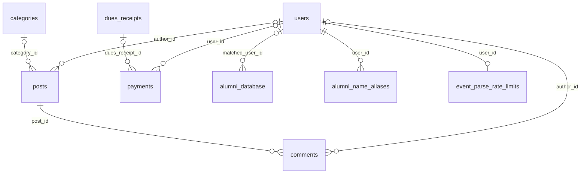

# 데이터베이스 스키마 기준서

현행 테이블·JSON·무결성 계약의 기준서다. 제품 정책은 [계획서](../product/planning-proposal.md), 직접 DB 작업은 [운영 런북](../runbooks/database-operations.md)을 따른다. 과거 14-table 구조, TEXT 본문, 단계별 catalog·digest·변환 결과는 [구조 변경 이력](../history/database-schema-2026-11-09.md)에 보존한다.

문서 분류와 별개로 테이블·컬럼·JSON·migration 계약과 마지막 DB 관찰 시각을 유지한다. 실행 파일의 종류·제약은 [DB 스크립트 분류](database-scripts.md)에 정리하며, 초기 migration을 현행 전체 스키마로 취급하지 않는다.

DB 구조를 바꾸지 않은 소스 정리 결과는 [개발 작업 이력](../history/README.md)에 둔다.

역사관의 공개 연혁·회장·임원·수상자·기부·문서는 `shared/heritage/`의 정적 자료로 관리한다. 회원 전용 사진첩의 목록과 사진은 환경별 비공개 Object Storage에 저장한다. PostgreSQL 구조·JSONB 계약을 변경하거나 회원 전용 `posts`·`payments`를 공개 자료로 사용하지 않는다. 데이터 계약은 [역사관 콘텐츠 기준](heritage-content.md)을 따른다. 아래 catalog 관찰 시각은 유지한다.

## 기준 소스와 마지막 DB 관찰

- 6.3.0의 기본명부·가입일·회원 이력과 별칭 소유자 UUID를 개발·운영 DB에 적용했다. 공통 정의는 [Drizzle의 12개 pgTable](../../server/db/schema/index.ts), [런타임 session](../../server/index.ts), [회원 상태 제약·이력 트리거](../../scripts/lib/member-status-contract.sql), [회비 원장·납부 연결 구조](../../scripts/lib/dues-ledger-contract.sql)를 따른다. shared/schema.ts는 서버용 호환 export다.
- 2026-11-21 17:57 KST 운영 전환 후 개발·운영에서 각각 새 읽기 전용 연결로 전체 catalog를 확인했다. 운영에는 회비 원장 구조만 적용했다. 원장 거래 이관과 연도별 등급 전환은 별도 작업이다. [운영 전환 기록](../history/release-6.3.0-2026-11-21.md)
- 양쪽 구조는 posts.content JSONB·is_hidden, posts 경조사 JSON, source_collection_rules를 포함한다. community_events·obituaries는 두 환경에서 제거됐다. 컬럼 표는 논리 순서이며 환경별 물리 순서 차이를 변경 지시로 삼지 않는다.

| 객체 | Development 마지막 관찰 | Production 마지막 관찰 |
|---|---|---|
| DB / PostgreSQL | heliumdb / 16.10 | neondb / 16.16 |
| tables / columns | 14 / 136 | 14 / 134 |
| PK / FK / non-PK UNIQUE / CHECK | 14 / 10 / 9 / 20 | 14 / 10 / 9 / 20 |
| indexes / sequences | 30 / 8 | 30 / 8 |
| view / trigger / policy / routine / enum / domain | 0 / 2 / 0 / 3 / 0 / 0 | 0 / 2 / 0 / 3 / 0 / 0 |
| RLS | 모든 public 테이블 비활성 | 모든 public 테이블 비활성 |

2026-11-25 밴드 이관 댓글의 복수 첨부 제약을 적용한 뒤 개발 DB의 읽기 전용 catalog에서 14개 테이블·136개 컬럼을 확인했다. 전체 출력 SHA-256은 `547ef824fb3c933c3dbf073697289a24885a57011f72c5d77c3509cc40094c0a`이다. [댓글 첨부 적용 기록](../history/band-development-import-2026-11-25.md#댓글-사진영상-복구와-개발-이관)

2026-11-25 글·댓글의 작성 당시 소속 컬럼을 추가한 뒤 새 읽기 전용 연결에서 개발 catalog 14개 테이블과 136개 컬럼을 확인했다. SHA-256은 `79cb76b89787a213d20980167c4336546f43b61fabb55ba4080c4b238600d253`이다. 11월 24일 회원 프로필 소속 컬럼 추가 직후의 지문은 `aa616a65931a54353aa3211f0b58349e3ee6de4255177868276cbc5c08f9a0ff`였다.

밴드 댓글 구조 적용 후 개발 catalog SHA-256은 `459ee3c7850c8c51d0ea45e7c0615f36f89c723f98a0310dd09440f8270a55ff`이다. [개발 적용과 실명 대조](../history/band-development-2026-11-22.md)

2026-11-26 운영 밴드 자료 시험에 필요한 게시판 스키마를 적용했다. 새 읽기 전용 `neondb` 연결에서 catalog 완료 표시와 위 구조를 확인했다. 적용 전 SHA-256은 `2c2a966cdab36e747d8fe6fffba609a5ce03676b0960307e482c25c36416238e`, 적용 후는 `93874ab8967eed1ef194099acf3ead420f6e4003dbfdbc7cc76fd1ec476ffe80`이다. 6.3.0 운영 전환 직후 지문은 `fc1556bfe5038cde23b825fbc74aef9c61976a8cffc9ddcf756edf7d1631bba4`다. [6.3.0 운영 전환](../history/release-6.3.0-2026-11-21.md)

[개발 회비 원장 스키마 적용](../history/dues-ledger-development-2026-11-21.md) 후 catalog SHA-256은 `b058205da01573cf9aa2b694f6bafe5c7441e899b822c45c8cd28315c33ee351`이다. 앞선 [회원 상태 개발 전환](../history/member-status-candidate-2026-11-21.md) 후 지문은 `aef0b2a7e9d466f03ebb5578b510bd87af6b379e72e3ff244627d4072d4b6e4e`이다. 직전 [개발 기본명부 전환](../history/users-roster-cutover-2026-11-21.md) 후 지문은 `914555133faa7530e8684b2d0540f7ada53d67f8c17010a2aeaf7c7dba91ada0`이다. [직전 가입일 적용 기록](../history/member-joined-at-2026-11-21.md) 이전 관찰은 [기본명부 적용 기록](../history/member-roster-fields-2026-11-21.md)과 [회원 UUID 전환 기록](../history/member-uuid-2026-11-20.md)에 있다. 이관 출처 적용 당시 catalog SHA-256은 `d397b65a46211d05f5f66b14817d4748c4736c7c7e2a51f63a8e3f26d860e2e2`이며 [이관 출처 적용 기록](../history/post-import-data-2026-11-14.md)을 따른다. 개발의 과거 댓글 네 컬럼·두 CHECK는 [댓글 확장 기록](../history/comments-drag-handle-2026-11-12.md)에 근거하며 catalog SHA-256은 `cf46305b8f63b3e72a43d4e8a969bbb5dce7b6e94f353b7dc0e4ab7e3ba2890d`다. 6.2.0 당시 운영 catalog SHA-256은 `3d289f57d9660707877e9e984ab77a1eb0d6055a20852ad2a98f49787dd17993`이며 [6.2.0 운영 전환](../history/release-6.2.0-2026-11-20.md)에서 확인했다. 수치는 관찰 요약이며 고정 통과 기준이 아니다.

운영 댓글 전환은 [운영 SQL](../../scripts/add-comment-management-production.sql)로 완료했다. 적용된 스크립트의 존재를 반복 실행 지시로 해석하지 않는다. 앱 운영 배포 상태는 [Replit 기준](../../replit.md#현재-적용-상태)과 구분한다.

운영 밴드 이전의 [게시 자료 SQL](../../scripts/add-band-content-production.sql)로 `posts.author_affiliation`, `comments.author_name`, `comments.author_affiliation`, `comments.parent_comment_id`, `comments.import_source_id`를 추가했다. 댓글의 같은 글 안 상위 관계와 원천 유일성을 강제하고 `comments_attachment_check`는 이관 댓글 복수 첨부 계약을 적용한다.

2026-11-15 개발 이관 사전 확인에서는 게시글 이관에 필요한 컬럼·CHECK·원본 인덱스·댓글 CASCADE만 읽기 전용으로 확인했다. 전체 catalog 관찰일·객체 수는 갱신하지 않는다. [사전 확인 기록](../history/community-readiness-2026-11-15.md)을 따른다.

## 현행 관계

개발·운영 모두 `dues_receipts → payments`를 포함해 물리 FK가 9개다. session·OAuth·가입 대기·수집 규칙은 별도 FK가 없다. JSON 안의 회원/출처와 Object Storage 경로는 논리 참조이며 물리 FK로 표시하지 않는다.

## 현행 테이블 사전

개발·운영 모두 `dues_receipts`를 포함한 테이블 14개를 사용한다. 회원 기본키와 이를 참조하는 외래키는 UUID이며 사전 등록 행에서는 이메일이 NULL일 수 있다. 모든 컬럼은 identity/generated가 없으며 serial은 명시된 nextval 기본값이다. `—`는 기본값 없음, NULL 열의 `허용`은 nullable이다. 각 제약의 세부 정의는 코드와 마지막 catalog를 함께 따른다.

### TABLE_ROW: users

고정 동문 UUID를 기본키로 보관한다. 가입 전에는 카카오 ID·이메일 없이 이름·졸업연도를 등록한다. 실제 가입 시 같은 행에 권한과 프로필을 연결한다.

| 컬럼 | PostgreSQL 타입 | NULL | 기본값 |
|---|---|---|---|
| `id` | `uuid` | 불가 | — |
| `kakao_id` | `text` | 허용 | — |
| `email` | `text` | 허용 | — |
| `name` | `text` | 불가 | — |
| `graduation_year` | `integer` | 허용 | — |
| `is_verified` | `boolean` | 허용 | `false` |
| `is_admin` | `boolean` | 허용 | `false` |
| `kakao_sync_enabled` | `boolean` | 허용 | `false` |
| `profile_image` | `text` | 허용 | — |
| `phone_number` | `text` | 허용 | — |
| `created_at` | `timestamp without time zone` | 허용 | `now()` |
| `updated_at` | `timestamp without time zone` | 허용 | `now()` |
| `birthday` | `text` | 허용 | — |
| `birthday_type` | `text` | 허용 | — |
| `is_leap_month` | `boolean` | 허용 | — |
| `activity_region` | `text` | 허용 | — |
| `affiliation` | `text` | 허용 | — |
| `affiliation_title` | `text` | 허용 | — |

선택 프로필 문구인 소속·직함은 `affiliation` 한 곳에 저장한다. 앞뒤 공백을 제거한 최대 100자이며 빈 입력은 NULL이다. `affiliation_title`은 직함별 필터 검토를 위해 남겨둔 컬럼으로, 현재 프로필 응답·수정에 사용하지 않는다. 2026-11-24 개발 DB에 추가했다. 새 읽기 전용 연결에서 두 컬럼 모두 nullable TEXT이고 기본값이 없으며, 기존 회원 행 3,461개가 유지되고 새 값은 모두 NULL임을 확인했다. 운영 적용에는 별도로 승인한 [회원 소속 SQL](../../scripts/add-user-affiliation-production.sql)을 사용한다.

가입일 컬럼 `users.joined_at`은 nullable TIMESTAMPTZ이며 기본값이 없다. 동문 행 생성 시각인 `created_at`과 별개로 가입 확정 시각을 기록하며 기존 행은 NULL로 둔다.

`users.alumni_status`는 NOT NULL이다. 값을 미가입·가입 대기·가입 완료·가입 거부·동문회 탈퇴자·사망 중 하나로 제한하고 기본값은 미가입으로 한다. `users.membership_history JSONB NOT NULL DEFAULT '[]'`에는 사건마다 type과 at만 추가한다. 회원 상태 변경과 이력 추가는 홈페이지·직접 SQL 모두 단일 DB 트리거에서 함께 처리한다. 최초 가입·재승인·재가입의 type은 모두 ‘가입 확정’이다. ‘사망 기록’의 at은 DB 기록 시각이다. 확인된 실제 사망일은 기존 명부 메모 `alumni_memo`에 기재한다. 사망은 최종 상태이며 가입 완료는 승인된 카카오 계정에만 허용한다. DB 제약 `users_alumni_status_check`·`users_approval_status_check`·`users_membership_history_check`와 BEFORE 트리거 `users_record_membership_change`가 이를 적용한다. 트리거 함수 `public.record_membership_change()`는 반복된 상태 변경을 건너뛰고 사망 전환 시 세션과 권한을 종료한다. 미확인 신청의 상태는 기존 신청 테이블에서만 관리한다. 전환 전 자료에는 과거 사건을 생성하지 않는다. [개발 전환 절차](../runbooks/database-operations.md#회원-상태와-변동-이력-전환)

기본명부 컬럼 10개는 TEXT다. `alumni_status`를 제외한 9개는 NULL을 허용하고 기본값은 없다. 시트 B~K 순서대로 `department`, `generation`, `alumni_name`, `admission_date`, `graduation_date`, `alumni_mobile`, `alumni_group`, `alumni_status`, `alumni_position`, `alumni_memo`다. 회원 프로필과 분리하며 날짜 정밀도·대체번호를 유지한다. A열은 기존 기본키와 대조한다. 두 환경에서 `users`의 해당 필드를 명부 정본으로 사용한다.

PK `users_pkey(id)`; UNIQUE `users_email_unique(email)`, `users_kakao_id_unique(kakao_id)`. 같은 이름의 btree 인덱스 3개. FK 없음.

관리자 심사는 users의 명부 10개 필드와 가입 프로필을 구분해 읽는다. 일반 회원 명부 응답은 UUID·연락처·메모를 제외한다. 가입 심사 기록은 pending_registrations에 보존한다.

### TABLE_ROW: categories

소유: Community Content. 목적: 공통 게시판 분류.

| 컬럼 | PostgreSQL 타입 | NULL | 기본값 |
|---|---|---|---|
| `id` | `integer` | 불가 | `nextval('categories_id_seq'::regclass)` |
| `name` | `text` | 불가 | — |
| `display_name` | `text` | 불가 | — |
| `color` | `text` | 허용 | `'#6b7280'::text` |
| `badge_variant` | `text` | 허용 | `'secondary'::text` |
| `is_active` | `boolean` | 허용 | `true` |
| `sort_order` | `integer` | 허용 | `0` |
| `created_at` | `timestamp without time zone` | 허용 | `now()` |
| `updated_at` | `timestamp without time zone` | 허용 | `now()` |

PK `categories_pkey(id)`; UNIQUE `categories_name_unique(name)`. 같은 이름의 btree 인덱스 2개. 부고·경사는 각각 obituary·celebration으로 분류하며 all은 목록 필터다.

### TABLE_ROW: posts

소유: Community Content / 경조사 모듈. 목적: 모든 게시글·경조사 초안·본문·첨부 경로.

| 컬럼 | PostgreSQL 타입 | NULL | 기본값 |
|---|---|---|---|
| `id` | `integer` | 불가 | `nextval('posts_id_seq'::regclass)` |
| `title` | `text` | 불가 | — |
| `content` | `jsonb` | 불가 | — |
| `category_id` | `integer` | 허용 | — |
| `author_id` | `uuid` | 허용 | — |
| `author_name` | `text` | 허용 | — |
| `author_affiliation` (개발) | `text` | 허용 | — |
| `import_data` | `jsonb` | 허용 | — |
| `is_published` | `boolean` | 허용 | `true` |
| `created_at` | `timestamp without time zone` | 허용 | `now()` |
| `updated_at` | `timestamp without time zone` | 허용 | `now()` |
| `image_urls` | `text[]` | 허용 | — |
| `event_data` | `jsonb` | 허용 | — |
| `source_text` | `text` | 허용 | — |
| `revision` | `integer` | 불가 | `0` |
| `published_at` | `timestamp without time zone` | 허용 | — |
| `is_hidden` | `boolean` | 불가 | `false` |

PK `posts_pkey(id)`; FK `posts_author_id_users_id_fk(author_id → users.id)`, `posts_category_id_categories_id_fk(category_id → categories.id)`, 삭제 NO ACTION. CHECK `posts_content_document_check`, `posts_notice_type_check`, `posts_revision_check`. PK 인덱스와 partial UNIQUE `posts_notice_draft_unique(author_id, (event_data->>'eventType')) WHERE is_published = false AND event_data IS NOT NULL`. 본문·JSON 계약은 아래 절을 따른다.

### TABLE_ROW: comments

소유: Community Content. 목적: 게시글 댓글.

밴드 개발 이관 댓글은 확인된 원작성자 실명을 `author_name`에 보관하고 `author_id`는 NULL로 둔다. 이관 댓글에는 비어 있지 않은 실명이 필요하다. 밴드 표시명만 확보한 댓글은 실명 확인 전까지 로컬 후보로 보존한다. `parent_comment_id`는 같은 게시글의 상위 댓글을 참조한다. 원댓글이면 NULL이다. `import_source_id`는 밴드 원댓글·답글을 구분하는 글별 고유 출처 키다. 원문의 댓글 번호는 상위 댓글마다 재사용될 수 있으므로 답글의 출처 키에는 상위 원댓글 번호도 포함한다. 일반 댓글 등록·수정 API는 이 세 필드를 받지 않는다.

2026-11-12 개발 03:14 KST·운영 03:47 KST에 네 컬럼·두 CHECK를 추가했다. 기존 다섯 컬럼의 타입·제약과 댓글을 유지했으며 개발 0건·운영 1건이다. [개발 기록](../history/comments-drag-handle-2026-11-12.md)과 [운영 전환](../history/release-3.0.0-2026-11-12.md#운영-db-적용)을 구분한다.

| 컬럼 | PostgreSQL 타입 | NULL | 기본값 |
|---|---|---|---|
| `id` | `integer` | 불가 | `nextval('comments_id_seq'::regclass)` |
| `post_id` | `integer` | 불가 | — |
| `author_id` | `uuid` | 허용 | — |
| `author_affiliation` (개발) | `text` | 허용 | — |
| `content` | `text` | 불가 | — |
| `created_at` | `timestamp without time zone` | 허용 | `now()` |

PK `comments_pkey(id)`; FK `comments_author_id_users_id_fk(author_id → users.id)` NO ACTION, `comments_post_id_posts_id_fk(post_id → posts.id)` ON DELETE CASCADE. 개발에는 `comments_post_id_id_unique(post_id, id)`, 같은 글 부모를 참조하는 `comments_same_post_parent_fk`, 출처가 있는 행만 검사하는 고유 인덱스 `comments_import_source_unique(post_id, import_source_id)` 및 일반 댓글과 이관 댓글을 구분하는 `comments_import_origin_check`가 있다. 계정 정리 시 게시된 댓글의 작성자 연결은 앱이 해제한다.

| 추가 컬럼 | PostgreSQL 타입 | NULL | 기본값 |
|---|---|---|---|
| `is_hidden` | `boolean` | 불가 | `false` |
| `edited_at` | `timestamp without time zone` | 허용 | — |
| `revision` | `integer` | 불가 | `0` |
| `attachment` | `jsonb` | 허용 | — |

`comments_revision_check`는 revision ≥ 0을 확인한다. 일반 댓글의 `attachment`는 NULL 또는 `objectPath`·`name`·`size`·`contentType`을 가진 단일 객체다. 개발 DB의 밴드 이관 댓글·답글에는 같은 JSONB 컬럼에 원본 순서대로 사진·영상 메타데이터 배열도 저장할 수 있다. 배열은 비어 있을 수 없으며 각 항목은 전용 비공개 경로를 사용한다. 서버는 App Storage의 실제 파일과 메타데이터를 검증한다. 댓글 본문은 `TEXT`다. 일반 등록·수정 API는 1,000자로 제한하며 밴드 이관 CLI는 원본에서 확인한 더 긴 댓글을 한 행으로 보존한다. 첨부가 있으면 빈 문자열을 허용한다.

작성자만 수정·삭제하고 관리자는 가리기·복원한다. 수정만 edited_at을 갱신하며 수정·가리기·복원은 revision을 증가시킨다. 일반 회원의 가린 댓글 응답은 content·attachment를 NULL로 지워 전달한다. 작성자·관리자에게도 부모 게시글 열람 권한을 적용하며 첨부 직접 접근은 부모 게시글과 댓글 상태를 모두 확인한다.

### TABLE_ROW: dues_receipts

두 환경에 설치된 회비수입 원장이다. 운영 전환 당시 원장과 개인별 납부는 각각 0건이었다. 실입금 한 건을 한 행으로 기록하고, 같은 입금에서 배분한 회원별 납부는 `payments`로 연결한다. [이관 설계](../product/annual-dues-database-design.md#적용-순서와-승인-범위)

| 컬럼 | PostgreSQL 타입 | NULL | 기본값 |
|---|---|---|---|
| `id` | `uuid` | 불가 | — |
| `received_on` | `date` | 불가 | — |
| `amount` | `integer` | 불가 | — |
| `bank_amount` | `integer` | 불가 | — |
| `unallocated_year` | `integer` | 허용 | — |
| `source_rows` | `jsonb` | 불가 | — |

PK `dues_receipts_pkey(id)`가 원거래의 중복을 막는다. CHECK 5개가 유한한 입금일, 양의 회비 몫(`amount`), 회비 몫 이상의 은행 총액(`bank_amount`), 미배분 회비의 귀속연도(1000~9999), 비어 있지 않은 원장 행 배열을 검증한다. 입금일은 한국 날짜이고 금액 단위는 원이다. 혼합 입금의 다른 용도 금액은 `bank_amount - amount`로 계산한다. 연도별·회원별 회비 집계에는 회비 몫만 포함한다.

`source_rows`의 각 행에는 회비수입 시트 A:H의 거래 사실, I열의 회원 표기, 귀속연도와 배분 키를 기록한다. 원장에 대표 수입과 개인별 분개가 함께 있으면 귀속연도가 있는 분개만 배열에 넣는다. 성명불상 입금은 원장에 미배분으로 남긴다.

### TABLE_ROW: payments

회원별 납부 기록이다. 홈페이지의 기존 연회비 합계 판정은 [회비 정책](../product/planning-proposal.md#회원-등급과-회비)을 따른다.

| 컬럼 | PostgreSQL 타입 | NULL | 기본값 |
|---|---|---|---|
| `id` | `integer` | 불가 | `nextval('payments_id_seq'::regclass)` |
| `user_id` | `uuid` | 허용 | — |
| `amount` | `integer` | 불가 | — |
| `year` | `integer` | 불가 | — |
| `type` | `text` | 불가 | — |
| `status` | `text` | 불가 | `'completed'::text` |
| `receipt_url` | `text` | 허용 | — |
| `created_at` | `timestamp without time zone` | 허용 | `now()` |
| `dues_receipt_id` | `uuid` | 허용 | — |
| `dues_allocation_key` | `uuid` | 허용 | — |

양쪽 DB에 PK `payments_pkey(id)`와 FK `payments_user_id_users_id_fk(user_id → users.id)`가 있다. `dues_receipt_id`는 `dues_receipts.id`를 참조하고 두 FK의 삭제·갱신 동작은 NO ACTION이다. `payments_dues_allocation_unique`가 원입금·배분 키 조합의 중복을 막는다. 두 제약에 각각 btree 인덱스가 있다.

`payments_dues_allocation_check`는 일반 납부에서는 원장 연결 두 값을 모두 NULL로 두고 `ledger_staged` 상태를 제외한다. 원장 배분에는 두 값을 모두 지정하고, 상태 `ledger_staged`, 유형 `연회비`, 양의 금액과 귀속연도 1000~9999를 요구한다. 기존 홈페이지의 납부 내역·등급 판정은 이 상태를 제외한다.

회원 연결이 해제되면 `payments_clear_dues_source_labels`가 해당 배분의 `user_id` 변경 후 실행된다. 트리거 함수 `clear_dues_allocation_identity()`는 `redact_dues_source_labels(jsonb, uuid[])`를 사용해 원장의 해당 `allocationKey`에 연결된 `label`·`memberLabel`을 ‘연결 해제’로 바꾼다. 원장 재대조 때도 해제된 연결과 원래 이름 표기를 되살리지 않는다. [DB 운영 런북](../runbooks/database-operations.md#개발-회비수입원장-이관)

### TABLE_ROW: alumni_database

Membership Registry가 보존하는 옛 명부다. 6.3.0의 기본명부는 `users`다.

| 컬럼 | PostgreSQL 타입 | NULL | 기본값 |
|---|---|---|---|
| `id` | `integer` | 불가 | `nextval('alumni_database_id_seq'::regclass)` |
| `department` | `text` | 불가 | — |
| `generation` | `text` | 불가 | — |
| `name` | `text` | 불가 | — |
| `admission_date` | `text` | 허용 | — |
| `graduation_date` | `text` | 허용 | — |
| `address` | `text` | 허용 | — |
| `mobile` | `text` | 허용 | — |
| `phone` | `text` | 허용 | — |
| `group` | `text` | 허용 | — |
| `status` | `text` | 허용 | — |
| `alumni_position` | `text` | 허용 | — |
| `memo` | `text` | 허용 | — |
| `is_matched` | `boolean` | 허용 | `false` |
| `matched_user_id` | `uuid` | 허용 | — |

PK `alumni_database_pkey(id)`; FK `alumni_database_matched_user_id_users_id_fk(matched_user_id → users.id)` NO ACTION; UNIQUE `alumni_database_mobile_unique(mobile)`. PK·UNIQUE 인덱스. `alumni_database_matched_user_id_unique`가 동문 UUID의 중복 연결을 막는다. 사전 등록 여부와 가입 연결 여부(`is_matched`)를 구분한다.

2026-11-12 사용자 결정에 따라 `address`·`phone`은 향후 사용을 위해 컬럼과 기존 값을 보존한다. 현재 Sheets `통합주소록`의 10개 관리 컬럼에는 두 항목이 없으므로 가져오기·변경 비교·fingerprint·insert/update payload에서 제외한다. 신규 행의 두 컬럼은 기존 nullable 정의에 따라 NULL이며, 기존 행의 값은 동기화로 덮어쓰지 않는다. `mobile`, 회원의 `phone_number`, 회원 연결 필드와 다른 조회 권한은 유지한다. 이 변경은 앱 자료 계약만 바꾸며 DDL·데이터 변환·catalog 재검증을 수행하지 않는다.

### TABLE_ROW: alumni_name_aliases

개발 명부의 2026-11-12 명시적 초기화는 이 종속 자료와 `alumni_database`의 행을 함께 제거하는 데이터 작업이다. 09:46 KST 새 연결에서 두 테이블 0건, 대상 컬럼·FK·trigger 유무·시퀀스 값의 전후 일치를 확인했다. 주소·전화 컬럼을 포함한 구조는 보존했다. 동기화 시 기존 값 보존과 별개이며 [초기화 기록](../history/alumni-reset-2026-11-12.md)에 제한된 metadata 확인과 실행 결과를 남긴다. 전체 catalog 관찰 시각은 변경하지 않는다.

후속 운영 초기화도 같은 두 테이블의 행만 대상으로 했다. 09:53 KST 새 `neondb` 연결에서 명부 3,458건·별칭 2건이 각각 0건으로 바뀌었고 대상 FK·trigger 유무·컬럼·시퀀스가 전후 동일함을 확인했다. 개발 결과와 구분한 제한된 metadata 확인이며 구조와 마지막 전체 catalog 관찰 시각은 변경하지 않았다.

개발·운영 모두 공식 이름과 개명 전 이름을 같은 동문 UUID에 연결한다.

| 컬럼 | PostgreSQL 타입 | NULL | 기본값 |
|---|---|---|---|
| `id` | `integer` | 불가 | `nextval('alumni_name_aliases_id_seq'::regclass)` |
| `user_id` | `uuid` | 불가 | — |
| `name` | `text` | 불가 | — |
| `normalized_name` | `text` | 불가 | — |
| `alias_type` | `text` | 불가 | — |
| `is_preferred` | `boolean` | 불가 | `false` |
| `created_at` | `timestamp without time zone` | 불가 | `now()` |

PK `alumni_name_aliases_pkey(id)`; FK `alumni_name_aliases_user_id_users_id_fk(user_id → users.id)` ON DELETE CASCADE. CHECK `alumni_name_aliases_type_check`는 current_name/former_name, `alumni_name_aliases_normalized_not_blank`는 비어 있지 않은 normalized_name. UNIQUE 인덱스 `alumni_name_aliases_alumni_normalized_unique(user_id, normalized_name)`, `alumni_name_aliases_preferred_unique(user_id) WHERE is_preferred = true`; lookup 인덱스 `alumni_name_aliases_normalized_idx(normalized_name)`. preferred 최대 1개를 강제한다.

### TABLE_ROW: pending_registrations

소유: Membership Registry. 목적: 가입 신청과 현재 심사 상태 보존.

| 컬럼 | PostgreSQL 타입 | NULL | 기본값 |
|---|---|---|---|
| `id` | `integer` | 불가 | `nextval('pending_registrations_id_seq'::regclass)` |
| `kakao_id` | `text` | 불가 | — |
| `email` | `text` | 불가 | — |
| `name` | `text` | 불가 | — |
| `user_data` | `jsonb` | 허용 | — |
| `status` | `text` | 허용 | `'pending'::text` |
| `created_at` | `timestamp without time zone` | 허용 | `now()` |

`created_at`은 신청 건의 최초 접수 시각이며 재로그인·재심사에서 보존한다.

PK·인덱스 `pending_registrations_pkey(id)`; FK·별도 UNIQUE 없음. user_data는 제한된 가입 payload이며 승인 취소로 생성·갱신한 신청은 conflictReason=`approval_cancelled`로 구분한다. 앱은 `pending`(승인 대기)·`approved`(인증 완료)·`rejected`(승인 거부)를 사용한다. 거부는 행을 보존하고 재심사는 rejected → pending으로만 이동한다. rejected 신청의 명시적 삭제는 unlink 성공 후 해당 카카오 신원의 신청 행을 지우고 기존 users·콘텐츠·회비·명부 연결은 보존한다. 기존 회원은 is_verified=false를 유지하며 kakao_sync_enabled=false로 연결 상태를 표시한다. 새 OAuth 재접속은 관리자 심사 신청으로 재등록한다. 자동 가입 회원은 신청 행이 없을 수 있어 인증 완료 목록은 users.is_verified=true를 기준으로 조회한다. 승인 취소는 회원의 is_verified=false와 pending 신청을 같은 트랜잭션에서 확정하고 세션을 삭제한다. 재승인 시 기존 회원 ID와 본인 명부 연결을 재사용한다. 구조·DDL 변경과 과거 자료 마이그레이션은 없으며 이번 문서 갱신은 catalog 재검증을 의미하지 않는다.

### TABLE_ROW: kakao_oauth_states

소유: Identity/Session. 목적: 일회성 OAuth state와 세션 binding.

| 컬럼 | PostgreSQL 타입 | NULL | 기본값 |
|---|---|---|---|
| `state_hash` | `text` | 불가 | — |
| `session_binding_hash` | `text` | 불가 | — |
| `expires_at` | `timestamp with time zone` | 불가 | — |
| `created_at` | `timestamp with time zone` | 불가 | `now()` |
| `started_at` | `timestamp with time zone` | 불가 | `now()` |

PK `kakao_oauth_states_pkey(state_hash)`; UNIQUE `kakao_oauth_states_session_binding_hash_unique(session_binding_hash)` 및 같은 이름의 인덱스 2개. FK 없음. 원문 state는 저장하지 않고 10분 만료와 일회성 소비를 앱이 처리한다.

### TABLE_ROW: kakao_identity_terminations

소유: Identity/Session. 목적: 연결 해제와 OAuth 종료 경쟁 marker.

| 컬럼 | PostgreSQL 타입 | NULL | 기본값 |
|---|---|---|---|
| `identity_hash` | `text` | 불가 | — |
| `terminated_at` | `timestamp with time zone` | 불가 | `now()` |

PK·인덱스 `kakao_identity_terminations_pkey(identity_hash)`; FK·별도 UNIQUE 없음. 카카오 회원번호/소문자 이메일의 도메인 분리 SESSION_SECRET HMAC-SHA-256과 종료 시각을 저장한다. identity별 최신 marker 1건만 upsert하며 종료보다 먼저 시작된 OAuth를 차단한다.

### TABLE_ROW: session

소유: Identity/Session. 목적: express-session·connect-pg-simple 런타임 저장소.

| 컬럼 | PostgreSQL 타입 | NULL | 기본값 |
|---|---|---|---|
| `sid` | `character varying` | 불가 | — |
| `sess` | `json` | 불가 | — |
| `expire` | `timestamp(6) without time zone` | 불가 | — |

PK `session_pkey(sid)`; btree `session_expire_idx(expire)`와 PK 인덱스. FK 없음. sess.userId는 논리 참조다. 앱 runtime DDL이 관리하고 Drizzle tablesFilter에서 제외한다. cookie maxAge 7일·prune 60초.

### TABLE_ROW: event_parse_rate_limits

소유: 경조사 모듈. 목적: 회원별 수집/생성 호출 제한.

| 컬럼 | PostgreSQL 타입 | NULL | 기본값 |
|---|---|---|---|
| `user_id` | `uuid` | 불가 | — |
| `window_started_at` | `timestamp with time zone` | 불가 | `now()` |
| `request_count` | `integer` | 불가 | `0` |
| `updated_at` | `timestamp with time zone` | 불가 | `now()` |

PK·인덱스 `event_parse_rate_limits_pkey(user_id)`; FK `event_parse_rate_limits_user_id_users_id_fk(user_id → users.id)` ON DELETE CASCADE. 앱이 윈도우별 카운터를 원자적으로 갱신한다.

### TABLE_ROW: source_collection_rules

소유: 경조사 모듈. 목적: 공개 API 조회·추출 규칙.

| 컬럼 | PostgreSQL 타입 | NULL | 기본값 |
|---|---|---|---|
| `id` | `integer` | 불가 | `nextval('source_collection_rules_id_seq'::regclass)` |
| `domain` | `text` | 불가 | — |
| `page_pattern` | `text` | 불가 | — |
| `rule` | `jsonb` | 불가 | — |
| `version` | `integer` | 불가 | `1` |
| `created_at` | `timestamp with time zone` | 불가 | `now()` |
| `updated_at` | `timestamp with time zone` | 불가 | `now()` |
| `last_success_at` | `timestamp with time zone` | 불가 | — |

PK `source_collection_rules_pkey(id)`; UNIQUE `source_collection_rules_domain_pattern_unique(domain, page_pattern)` 및 같은 이름의 인덱스 2개. CHECK `source_collection_rules_version_check`는 version > 0, `source_collection_rules_json_check`는 rule object·schemaVersion=1을 IS TRUE로 확인한다. FK 없음. 앱 서버만 저장소를 사용한다.

## 본문 Tiptap JSONB 계약

`posts.content jsonb NOT NULL`이 유일한 본문 정본이다. 표준 `{ "type": "doc", "content": [...] }` 문서를 저장한다. HTML·Markdown·일반 텍스트는 입력 또는 파생 결과이며 별도 편집 가능한 원본 컬럼이 없다. 본문 CHECK는 object·type=doc·content array를 IS TRUE로 확인한다.

- 노드: doc, paragraph, text, heading(H1~H4), hardBreak, blockquote, codeBlock, horizontalRule, bulletList, orderedList, listItem, image, youtube, table, tableRow, tableCell, tableHeader.
- 마크: bold, italic, strike, underline, code, link.
- 2026-11-12 후속 결정으로 체크리스트 노드·속성 검증을 앱 스키마에서 제거한다. YouTube는 공식 `youtube` 노드에 검증된 영상 주소·표시 속성을 저장한다. 편집·서버 검증·상세는 같은 스키마를 사용하고 원래 JSONB 컬럼과 루트 CHECK를 유지한다. Placeholder·CharacterCount는 저장 필드를 추가하지 않는다. 정식 운영 전 테스트 본문의 사용 조회·호환 변환·완료 상태 보존·원문 이력·백업은 수행하지 않으며, DB DDL·catalog 재조회도 필요하지 않다.
- 2026-11-12 일반 파일 첨부는 기존 `posts.content` JSONB의 `paragraph`·`text`·`link`만 사용한다. 링크 `href`는 `/objects/` 경로이며 파일명·크기는 본문 텍스트로 저장한다. 원본 파일과 다운로드 이름·실제 크기는 App Storage에 둔다. `image_urls`에는 일반 파일을 넣지 않는다. 링크 경로도 이미지와 함께 개수·열람 권한을 검사하며 가린 글의 파일 참조 조회에 포함한다. 테이블·컬럼·CHECK·기존 행 변환·catalog 재조회가 필요하지 않다.
- 2026-11-12 TableKit 표 구조와 공식 셀 속성 `colspan`·`rowspan`(양의 정수), `colwidth`(null 또는 열 수에 맞는 비음수 정수 배열), `align`(null/left/center/right)을 같은 JSONB에 저장한다. 문서 스키마·격자 검증을 거치며 임의 배열/객체 속성은 허용하지 않는다. 병합을 펼친 전체 표 격자에도 기존 10,000 복잡도 한도를 적용하고 행별 셀 수를 먼저 확인한 뒤 공식 TableMap으로 충돌·누락을 검사한다. 표 안의 이미지에도 기존 경로·개수·권한 검사를 적용한다. 앱 JSON 계약 확장으로서 DB DDL·기존 행 변환·catalog 재조회는 없다. 구현·정적 검사 상태는 [TableKit 개발 기록](../history/table-kit-2026-11-12.md)을 따른다.
- [공통 문서 계약](../../shared/contracts/post-document.ts)과 [공식 Tiptap 스키마·변환](../../shared/editor/post-document.ts)이 세부 노드·속성·크기·링크를 검사한다. 본문 `image` 노드는 공식 Image 스키마를 사용하며 `src`는 유효한 `/objects/` 상대 경로만 허용한다. 이미지 바이너리·data/blob URL·외부 이미지 URL·임의 HTML은 저장하지 않는다.
- 2026-11-11 본문 이미지 확장은 기존 JSONB의 앱 계약 변경이며 컬럼·CHECK·마이그레이션·기존 행 변환은 없다. `image_urls`는 별도 첨부를 그대로 보존하고 본문 이미지 경로를 중복 저장하지 않는다. 이미지 합계 제한·저장 권한은 본문 노드와 별도 첨부를 함께 검사한다. 열람 참조 조회도 두 위치를 확인해 가린 글의 이미지가 미첨부 파일로 취급되지 않게 한다. [개발 반영과 정적 검사](../history/inline-images-2026-11-11.md)까지 수행했으며 운영 코드 적용·DB 실행·catalog 재조회는 하지 않았다.
- 입력·복원·미리보기·상세·저장 API는 같은 JSON을 사용한다. 목록 요약과 검색은 text 노드 및 줄 경계에서 파생하고 JSON 속성명·링크 속성을 검색 본문으로 취급하지 않는다.
- 서식 편집기는 JSON 원본을 직접 편집한다. HTML·Markdown 붙여넣기와 경조사 생성의 Markdown→JSON 변환은 유지하며 Markdown 소스 모드·전용 복사·전체 본문의 왕복 변환 UI는 제공하지 않는다. 편집기 버전·호환성은 [본문 편집기 기준](post-editor.md)을 따른다.

개발의 기존 0건과 운영의 기존 3건을 구분해 변환한 기록은 [본문 전환 이력](../history/database-operations-2026-11-09.md#본문-운영-전환-결과)에 있다. 현재 TEXT라고 해석하거나 변환을 다시 실행하지 않는다.

## 게시글과 경조사 JSON 계약

일반 게시글 API의 제목 1~300자·본문 이미지·일반 파일/별도 첨부 합계 40개 및 기존 값 보존 기준은 [제품 정책](../product/planning-proposal.md#일반-게시글-입력과-초안-수명)을 따른다. 일반 파일은 표준 링크의 고유 `/objects/` 경로 기준으로 게시글당 5개이며 파일당 10MB다. 이미지는 파일당 5MB를 유지한다. 이는 앱 입력 계약이며 PostgreSQL 컬럼·CHECK·기존 저장 본문을 변경하거나 기존 행을 일괄 변환하지 않는다.

밴드 개발 이관에서 원글과 사진 색인을 대조한 일반 글은 전체 사진 경로를 원래 순서대로 `posts.image_urls`에 저장할 수 있다. 사진 수가 40개를 초과하는 경우에도 같은 원글에서 확인한 사진 ID와 저장 파일을 검증한다. 역사관에 수록한 사진은 회원 전용 카탈로그에 두고 `posts.content`에서 해당 앨범으로 연결한다. [밴드 이관 절차](../runbooks/community-migration.md#개발-이관과-검산)

- 모든 posts·categories·댓글·검색·첨부 API는 회원 전용이다. 본문 공개 여부를 JSON·클라이언트가 정하지 않는다. 작성자 본인 수정·삭제와 관리자 가리기/다시 표시하기를 서버가 분리한다.
- is_published는 초안/게시, is_hidden은 가림 상태다. 정상 목록·검색은 게시됨+가리지 않음으로 제한한다. 가린 글은 작성자/관리자만 관리하고 댓글 추가는 막는다. 작성자 수정은 가림·최초 게시 시각을 바꾸지 않는다.
- 경조사 사실은 content와 별개인 event_data다. [NoticeData](../../shared/contracts/notices.ts)는 schemaVersion=1, eventType=obituary/wedding/opening, facts, questions, sources 및 선택 fieldSources를 가진다. 일반 글은 event_data/source_text가 NULL이다.
- posts_notice_type_check는 JSON schemaVersion·eventType을 IS TRUE로 검사하고 posts_revision_check는 revision >= 0이다. 세부 사실·신원·회원 등급은 서버가 판정한다. partial UNIQUE와 작성자/유형 advisory lock으로 유형별 미발행 초안 하나를 관리한다.
- source_text는 초안의 작성자 입력만 저장하고 게시할 때 지운다. 게시 응답에 입력 원문과 내부 사실 JSON을 노출하지 않는다. 원문 변경·생성·게시와 편집은 revision으로 충돌을 확인한다.
- 경조사는 텍스트·링크 → 정규화된 사실 → 질문/정적 문안 → 미리보기 → 작성자 확인 후 게시 흐름이다. 게시된 글 정정은 15분 서명에 글·작성자·revision을 묶고 저장 직전 신원·문안을 다시 확인한다. 별도 DB 미리보기 사본은 없다.
- 정정 입력의 출처를 먼저 배치하고 같은 URL은 최신 결과로 갱신한다. 다른 기존 출처·필드별 근거는 보존하고 링크 없는 정정은 기존 링크를 유지한다. 차단된 링크는 표시하지 않는다.
- 결혼 선택 키 groomName/brideName/weddingPartyRole/childAdmissionYear/childGraduationClass/address/meal/parking/flowerPolicy를 지원한다. 호환 childAlumniInfo/childMemberType은 회원 신원·등급의 권위가 아니다. 자녀도 명부·회원 상태로 확인하며 계좌·연락처 공개 범위는 [제품 정책](../product/planning-proposal.md#결혼개원-보완-범위-2026-11-09)을 따른다.

## 수집 규칙 JSON 계약

[source_collection_rules의 앱 계약](../../server/integrations/public-sources/collection-contract.ts)은 strict schema다. schemaVersion=1, domain, pagePattern, 선택 noticeTypes, id.source/key/transform, request.method/urlTemplate, fields[].field/path, shape[].path/type을 저장한다.

- noticeTypes는 obituary/wedding/opening이며 없는 과거 규칙은 부고 전용으로 읽는다. 실제 수집한 유형과 응답 구조·필수 사실을 충족한 규칙만 사용한다.
- 요청은 인증 없는 GET, ID는 URL path/query의 identity/base64url 변환만 지원한다. 개별 ID 대신 `{id}` 템플릿을 저장한다. 허용된 짧은 청첩장 slug도 같은 페이지 대응 검사를 거친다.
- 매핑은 부고·결혼·개원의 유형별 필드를 구분한다. 필드별 출처 kind는 user/html/api/rendered/ocr/unresolved이며 posts.event_data.fieldSources에 연결한다. 개별 원문·개인정보·쿠키·인증정보·실행 코드는 규칙에 넣지 않는다.
- 앱 서버의 [규칙 저장소](../../server/modules/events/collection-rule-store.ts)가 같은 domain/page_pattern을 upsert하며 version+1·updated_at·last_success_at을 갱신한다. 재사용 성공은 last_success_at만 갱신한다. 외부 브라우저에는 DB 접속정보를 전달하지 않는다.
- 최신 원본을 재조회하고 불일치 시 범용 수집으로 재탐색한다. HTTP 200만으로 성공 처리하지 않으며 저장 규칙에도 공개 주소·응답 검사를 적용한다.

## 무결성과 수명

- 같은 DB를 쓰는 modular monolith를 유지한다. Identity/Registry의 가입·승인·탈퇴와 명부 claim은 관련 행을 한 트랜잭션으로 처리한다. 도메인을 나눴다는 이유로 트랜잭션을 분산하지 않는다.
- 신규 기수 등록과 명부 정정은 고정 UUID를 기준으로 전용 CLI 또는 SQL에서 처리한다. pending/payment 상태 허용값, category와 post의 표시 관계는 앱 계약이며 모두 DB CHECK로 강제된 것은 아니다.
- 가입 거부·승인 취소는 계정·콘텐츠·납부·명부 연결을 보존하고 대기·거부 상태와 세션 접근을 관리한다. 진행 중 OAuth는 기존 종료 marker로 무효화하고, 서버는 저장된 회원 승인 상태를 다시 확인한다. 거부 신청 삭제는 Kakao unlink 확인 후 신청만 삭제하며 기존 회원 자료를 유지한다. 회원 탈퇴는 Kakao unlink 확인 후 아래 계정 정리를 수행한다. 미발행 경조사 초안은 삭제하고 게시 콘텐츠·납부 기록의 회원 연결은 해제한다. 명부의 고정 UUID를 보존하고 가입 연결 상태와 카카오 프로필을 해제한다.
- 작성자 게시글 삭제는 댓글 CASCADE를 사용하고 Object Storage 파일은 물리 삭제하지 않는다. 가리기는 본문·댓글을 보존한다. Object Storage 고아 파일 정리와 추가 보존 기간은 별도 제품 결정 사항이다.
- 회원·명부·본문·연락처·계좌는 필요한 업무 저장소에서만 취급한다. Secret·연결 문자열·행 원문은 이 스키마 문서나 catalog에 포함하지 않는다. 세션/OAuth의 명시된 만료와 회원 탈퇴 동작 외에 미확정 보존 기간을 만들어 적지 않는다.

## 비테이블 객체와 재검증

serial 소유 시퀀스는 categories/posts/comments/payments/alumni_database/alumni_name_aliases/pending_registrations/source_collection_rules의 8개다. last_success_at에는 기본값이 없다. 개발·운영의 사용자 트리거 `users_record_membership_change`와 `payments_clear_dues_source_labels`는 모두 활성(`tgenabled = O`)이다. 루틴 3개는 두 트리거 함수와 회비 원장 이름 표기 정리 함수다.

현재 구조는 [DDL 코드](../../server/db/schema/index.ts), runtime session 및 승인된 전환 결과를 함께 따른다. 회비 원장과 납부 연결 컬럼은 Drizzle 정의 밖에 있고 [tablesFilter](../../drizzle.config.ts)는 session만 제외한다. 개발 DB 전체에 `db:push`를 실행하면 원장·연결 컬럼이 삭제 후보에 들어갈 수 있으므로 회비 원장은 전용 SQL로 관리한다. 초기 `migrations/0000_cheerful_nick_fury.sql`은 전체 현행 구조의 재현 경로가 아니다. 구 테이블·옛 이관 SQL은 현행 생성 대상으로 복원하지 않는다.

실제 metadata-only 재검증은 [DB 런북](../runbooks/database-operations.md#스키마-카탈로그-재검증)의 대상·READ ONLY·ROLLBACK·완료 marker와 [catalog SQL](../../scripts/database-schema-catalog.sql)을 사용한다. 현재 코드 설명·마지막 관찰·새 실행 결과를 구분하고, DB를 읽지 않은 문서 수정일로 관찰 시각을 바꾸지 않는다.

## 로컬 커뮤니티 백업·이관 작업 DB

2026-11-13 사용자 승인으로 `local-backups/community/archive.sqlite3`를 로컬에만 둔다. PostgreSQL 앱 스키마와 별개이며 Replit에 이관 전용 테이블을 만들거나 SQLite를 업로드하지 않는다. `sources`는 플랫폼별 수집 상태, `source_items`는 원본 ID·원문/파일 참조·해시, `assets`는 파일 확보 상태, `conversions`는 형식 변환·검증, `migration_items`는 원본/대상 ID 대응·분류·변환 본문·환경별 적용 상태를 관리한다. 원본 복합 키를 사용하고 재수집에서 누락됐다는 이유로 기존 행을 삭제하지 않는다. 수집·보존은 [백업 운영 문서](../runbooks/community-backup.md), 변환·적용은 [이관 기준](../product/community-archive-migration-proposal.md)을 따르며 실제 결과는 로컬 백업 색인에 구분한다.

명시적인 변환 선택은 로컬 `conversions/selected-overrides.json`에서 원본·변환본 해시로 확인한 뒤 일반 CLI 변환 기록보다 우선 색인한다. `dbpl-35`에는 사용자 제공 한컴오피스 HWPX를 선택했으며, 이를 rhwp 자동 검사 통과로 표시하지 않는다. 역사관 사진첩은 `posts` 이관 대상과 분리한다. 2026-11-14 회원 전용 사진첩의 정본은 환경별 비공개 Object Storage의 목록 JSON과 사진이며 [자료 계약](heritage-content.md)을 따른다. PostgreSQL 구조 변경이나 catalog 재조회는 하지 않았다.

다음카페 일반 글은 기존 nullable `posts.author_id`를 NULL로 등록한다. 원작성자는 posts.author_name, 원작성일·출처는 posts.import_data에 저장한다. 계정 없는 글의 화면 표시는 탈퇴 추정 대신 계정 미연결로 처리한다.

## 게시글 작성자 이름 표시

회원 작성분의 이름은 조회 시점에 `users.name`에서 읽는다. `posts.author_affiliation`과 `comments.author_affiliation`에는 작성자 프로필의 `users.affiliation` 한 줄(최대 100자)을 최초 게시·댓글 등록 시 저장한다. NULL은 당시 기록이 없는 경우다. 작성·수정 API는 이 값을 입력받지 않는다. 기존 글·댓글에는 현재 프로필을 소급하지 않는다.

`posts.author_name`은 계정 미연결 이관 글의 원작성자 이름을 저장하는 nullable TEXT다. 회원용 조회는 `author_id`가 있으면 연결된 `users.name`, 없으면 `author_name`, 둘 다 없으면 ‘작성자 정보 없음’으로 표시한다. 밴드 이관 시 사무국이 당시 직책을 명시해 확인한 재학생은 게시글·댓글의 `author_name`에 ‘당시 직책 실명’으로 표시한다. 표시 이름은 권한 판정에 사용하지 않는다. 일반 작성·수정 API는 원작성자 이름 입력을 받지 않으며 기존 회원 연결·수정·삭제·관리자 가림 정책을 유지한다. 개발·운영 양쪽에 이 컬럼이 있다.

개발 적용 확인(2026-11-14): heliumdb.posts.author_name TEXT NULL, posts 87→87. metadata-only catalog 완료 marker 확인, SHA-256 `29e405a77d3a6666ce1b8889874b9473c50da31afaced227ffe9adb3839f65b2`. 운영의 2026-11-20 catalog에서도 같은 컬럼을 확인했다.

## 동문 원본 전환 설계

회원 키는 `users.id UUID PRIMARY KEY` 하나다. 게시글·댓글의 작성자, 납부 회원, 명부 연결 회원과 경조사 요청 제한의 회원 FK도 UUID를 사용한다. 기본값은 없으며 최초 명부 이관 시 `통합주소록` A열의 값을 그대로 저장한다. 개발 DB는 기존 계정을 유지해 전환했다. 운영의 마지막 관찰과 개발 결과는 위 표에 구분했다. [동문 전환 계획](../product/pre-migration-database-design.md#구현과-전환-순서)

## 게시글 이관 출처 저장

posts.import_data JSONB NULL에 schemaVersion=1, platform(daum-cafe/band), containerId, sourceId(게시판을 포함한 원본 ID), boardPath, url, originalCreatedAt(시간대 포함 ISO), timePrecision(day/minute), importedAt을 저장한다. 원작성자 이름은 author_name에 유지한다. 일반 글은 NULL이며 일반 작성·수정 입력에서 두 이관 필드를 받지 않는다. 원문은 content에, 원작성일·출처는 본문 밖 메타데이터 영역에 표시한다. 날짜만 확인된 원문에 시각을 표시하지 않고 한국 시간으로 표시한다.

개발·운영 DB에 컬럼·구조 CHECK·platform/containerId/sourceId 부분 UNIQUE 인덱스를 둔다. 일반 글의 출처는 NULL이다. 이관 글의 화면 표시일은 `import_data.originalCreatedAt`과 `timePrecision`으로 정한다. `published_at`은 이관 시 원작성 시각을 UTC로 변환해 정렬에 사용하고, `created_at`은 대상 행을 생성한 시각이다.

개발에 `posts_import_data_check`와 `posts_import_source_unique` 부분 UNIQUE 인덱스를 적용했다. 출처 객체는 아래 필드를 모두 요구하고 추가 키를 허용하지 않는다. 일반 게시글은 NULL을 허용한다. 기존 게시글 87건은 유지되며 import_data 입력은 0건이다. [실행 기록](../history/post-import-data-2026-11-14.md)에 catalog와 정적 검사 근거를 남긴다.

| JSON 필드 | 계약 |
|---|---|
| schemaVersion | 숫자 1 |
| platform | daum-cafe 또는 band |
| containerId | 카페/밴드 식별자, 1~500자 |
| sourceId | 게시판을 포함한 원본 고유 ID, 1~500자. 밴드 이관 글은 피드의 원글 번호. 가입 환영 카드 번호는 로컬 백업에서만 관리 |
| boardPath | 원본 대분류→게시판 문자열 배열, 1~8단계 |
| url | 인증정보 없는 HTTP(S) 원문 주소, 최대 4096자 |
| originalCreatedAt | 시간대가 포함된 ISO 원작성 시각 |
| timePrecision | day 또는 minute. 날짜만 확인되면 KST 해당 날짜의 자정을 저장하되 시각을 표시하지 않음 |
| importedAt | 시간대가 포함된 ISO 이관 시각 |

앱 검증 계약은 [post-import.ts](../../shared/contracts/post-import.ts), DB CHECK는 [post-import-check.ts](../../server/db/schema/post-import-check.ts)다. 실제 이관 도구는 앱 계약으로 검증한 값을 저장해야 하며, 이번 단계에서는 이관 도구의 데이터 쓰기 경로를 실행하지 않았다.
