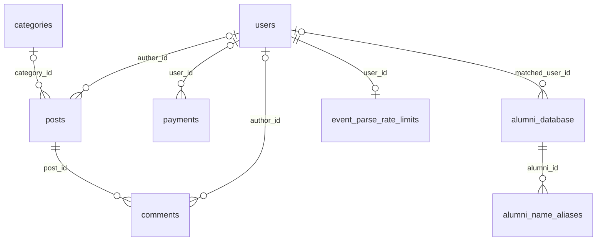

# 데이터베이스 스키마 기준서

현행 테이블·JSON·무결성 계약의 기준서다. 제품 정책은 [계획서](../product/planning-proposal.md), 직접 DB 작업은 [운영 런북](../runbooks/database-operations.md)을 따른다. 과거 14-table 구조, TEXT 본문, 단계별 catalog·digest·변환 결과는 [구조 변경 이력](../history/database-schema-2026-11-09.md)에 보존한다.

문서 분류와 별개로 테이블·컬럼·JSON·migration 계약과 마지막 DB 관찰 시각을 유지한다. 실행 파일의 종류·제약은 [DB 스크립트 분류](database-scripts.md)에 정리하며, 초기 migration을 현행 전체 스키마로 취급하지 않는다.

DB 구조를 바꾸지 않은 소스 정리 결과는 [개발 작업 이력](../history/README.md)에 둔다.

## 기준 소스와 마지막 DB 관찰

- 코드 기준: 문서 정리 시작 시 main `d7184ca`, [server/db/schema/index.ts](../../server/db/schema/index.ts)의 12개 pgTable과 [server/index.ts](../../server/index.ts)의 runtime session. shared/schema.ts는 서버용 호환 export다.
- DB 관찰: Development 2026-11-09 20:09 KST, Production 20:30 KST 가림 컬럼 추가 후 metadata-only catalog. 문서 정리에서는 DB에 연결하거나 catalog를 재수집하지 않았다.
- 양쪽 구조는 posts.content JSONB·is_hidden, posts 경조사 JSON, source_collection_rules를 포함한다. community_events·obituaries는 두 환경에서 제거됐다. 컬럼 표는 논리 순서이며 환경별 물리 순서 차이를 변경 지시로 삼지 않는다.

| 객체 | Development 마지막 관찰 | Production 마지막 관찰 |
|---|---|---|
| DB / PostgreSQL | heliumdb / 16.10 | neondb / 16.15 |
| tables / columns | 13 / 103 | 13 / 103 |
| PK / FK / non-PK UNIQUE / CHECK | 13 / 8 / 6 / 7 | 13 / 8 / 6 / 7 |
| indexes / sequences | 24 / 9 | 24 / 9 |
| view / trigger / policy / routine / enum / domain | 모두 0 | 모두 0 |
| RLS | 모든 public 테이블 비활성 | 모든 public 테이블 비활성 |

관찰 근거는 [가리기 적용 catalog](../history/database-schema-2026-11-09.md#게시글-관리-추가-계약-2026-11-09)와 [운영 런북 이력](../history/database-operations-2026-11-09.md#게시글-가리기-운영-적용-결과)이다. 개발 catalog SHA-256은 `453a1924708cc258dec6385be2f461753813747d8ee2a7226f63dd47c2c11e5a`, 운영은 `27588cbda434da037691dbf79f754ed8956b5b01fdc082a83227f3479eed8262`다. 수치는 마지막 관찰의 요약이며 향후 고정 통과 기준이 아니다.

## 현행 관계

위는 물리 FK 8개다. session·OAuth·가입 대기·수집 규칙은 별도 FK가 없다. JSON 안의 회원/출처와 Object Storage 경로는 논리 참조이며 물리 FK로 표시하지 않는다.

## 현행 테이블 사전

아래 13개 테이블이 현재 전체 사전이다. 모든 컬럼은 identity/generated가 없으며 serial은 명시된 nextval 기본값이다. `—`는 기본값 없음, NULL 열의 `허용`은 nullable이다. 각 제약의 세부 정의는 코드와 마지막 catalog를 함께 따른다.

### TABLE_ROW: users

소유: Identity/Session. 목적: 카카오 회원·권한·프로필.

| 컬럼 | PostgreSQL 타입 | NULL | 기본값 |
|---|---|---|---|
| `id` | `integer` | 불가 | `nextval('users_id_seq'::regclass)` |
| `kakao_id` | `text` | 허용 | — |
| `email` | `text` | 불가 | — |
| `name` | `text` | 불가 | — |
| `graduation_year` | `integer` | 허용 | — |
| `is_verified` | `boolean` | 허용 | `false` |
| `is_admin` | `boolean` | 허용 | `false` |
| `kakao_sync_enabled` | `boolean` | 허용 | `false` |
| `profile_image` | `text` | 허용 | — |
| `phone_number` | `text` | 허용 | — |
| `created_at` | `timestamp without time zone` | 허용 | `now()` |
| `updated_at` | `timestamp without time zone` | 허용 | `now()` |
| `birthday` | `text` | 허용 | — |
| `birthday_type` | `text` | 허용 | — |
| `is_leap_month` | `boolean` | 허용 | — |
| `activity_region` | `text` | 허용 | — |

PK `users_pkey(id)`; UNIQUE `users_email_unique(email)`, `users_kakao_id_unique(kakao_id)`. 같은 이름의 btree 인덱스 3개. FK 없음.

### TABLE_ROW: categories

소유: Community Content. 목적: 공통 게시판 분류.

| 컬럼 | PostgreSQL 타입 | NULL | 기본값 |
|---|---|---|---|
| `id` | `integer` | 불가 | `nextval('categories_id_seq'::regclass)` |
| `name` | `text` | 불가 | — |
| `display_name` | `text` | 불가 | — |
| `color` | `text` | 허용 | `'#6b7280'::text` |
| `badge_variant` | `text` | 허용 | `'secondary'::text` |
| `is_active` | `boolean` | 허용 | `true` |
| `sort_order` | `integer` | 허용 | `0` |
| `created_at` | `timestamp without time zone` | 허용 | `now()` |
| `updated_at` | `timestamp without time zone` | 허용 | `now()` |

PK `categories_pkey(id)`; UNIQUE `categories_name_unique(name)`. 같은 이름의 btree 인덱스 2개. 부고·경사는 각각 obituary·celebration으로 분류하며 all은 목록 필터다.

### TABLE_ROW: posts

소유: Community Content / 경조사 모듈. 목적: 모든 게시글·경조사 초안·본문·첨부 경로.

| 컬럼 | PostgreSQL 타입 | NULL | 기본값 |
|---|---|---|---|
| `id` | `integer` | 불가 | `nextval('posts_id_seq'::regclass)` |
| `title` | `text` | 불가 | — |
| `content` | `jsonb` | 불가 | — |
| `category_id` | `integer` | 허용 | — |
| `author_id` | `integer` | 허용 | — |
| `is_published` | `boolean` | 허용 | `true` |
| `created_at` | `timestamp without time zone` | 허용 | `now()` |
| `updated_at` | `timestamp without time zone` | 허용 | `now()` |
| `image_urls` | `text[]` | 허용 | — |
| `event_data` | `jsonb` | 허용 | — |
| `source_text` | `text` | 허용 | — |
| `revision` | `integer` | 불가 | `0` |
| `published_at` | `timestamp without time zone` | 허용 | — |
| `is_hidden` | `boolean` | 불가 | `false` |

PK `posts_pkey(id)`; FK `posts_author_id_users_id_fk(author_id → users.id)`, `posts_category_id_categories_id_fk(category_id → categories.id)`, 삭제 NO ACTION. CHECK `posts_content_document_check`, `posts_notice_type_check`, `posts_revision_check`. PK 인덱스와 partial UNIQUE `posts_notice_draft_unique(author_id, (event_data->>'eventType')) WHERE is_published = false AND event_data IS NOT NULL`. 본문·JSON 계약은 아래 절을 따른다.

### TABLE_ROW: comments

소유: Community Content. 목적: 게시글 댓글.

| 컬럼 | PostgreSQL 타입 | NULL | 기본값 |
|---|---|---|---|
| `id` | `integer` | 불가 | `nextval('comments_id_seq'::regclass)` |
| `post_id` | `integer` | 불가 | — |
| `author_id` | `integer` | 허용 | — |
| `content` | `text` | 불가 | — |
| `created_at` | `timestamp without time zone` | 허용 | `now()` |

PK `comments_pkey(id)`; FK `comments_author_id_users_id_fk(author_id → users.id)` NO ACTION, `comments_post_id_posts_id_fk(post_id → posts.id)` ON DELETE CASCADE. 인덱스는 PK. 계정 정리 시 게시된 댓글의 작성자 연결은 앱이 해제한다.

### TABLE_ROW: payments

소유: Dues. 목적: 내부 납부 기록·권리회원 판정. 목표 판정 정책은 [공개 규정 기준 결정](../decisions/0005-membership-public-regulations.md)을 따른다. 현재 테이블·서버는 기존 연회비 합계 판정이며 직책별 월납·조정·과거 상태의 구현은 별도다. 이 결정으로 DB 구조를 변경하거나 catalog 관찰 시점을 갱신하지 않았다.

| 컬럼 | PostgreSQL 타입 | NULL | 기본값 |
|---|---|---|---|
| `id` | `integer` | 불가 | `nextval('payments_id_seq'::regclass)` |
| `user_id` | `integer` | 허용 | — |
| `amount` | `integer` | 불가 | — |
| `year` | `integer` | 불가 | — |
| `type` | `text` | 불가 | — |
| `status` | `text` | 불가 | `'completed'::text` |
| `receipt_url` | `text` | 허용 | — |
| `created_at` | `timestamp without time zone` | 허용 | `now()` |

PK `payments_pkey(id)`; FK `payments_user_id_users_id_fk(user_id → users.id)` NO ACTION. 인덱스는 PK. 실제 결제 provider 계약은 별도이며 계정 정리 시 사용자 연결을 해제한다.

### TABLE_ROW: alumni_database

소유: Membership Registry. 목적: Google Sheets 명부 런타임 복제본.

| 컬럼 | PostgreSQL 타입 | NULL | 기본값 |
|---|---|---|---|
| `id` | `integer` | 불가 | `nextval('alumni_database_id_seq'::regclass)` |
| `department` | `text` | 불가 | — |
| `generation` | `text` | 불가 | — |
| `name` | `text` | 불가 | — |
| `admission_date` | `text` | 허용 | — |
| `graduation_date` | `text` | 허용 | — |
| `address` | `text` | 허용 | — |
| `mobile` | `text` | 허용 | — |
| `phone` | `text` | 허용 | — |
| `group` | `text` | 허용 | — |
| `status` | `text` | 허용 | — |
| `alumni_position` | `text` | 허용 | — |
| `memo` | `text` | 허용 | — |
| `is_matched` | `boolean` | 허용 | `false` |
| `matched_user_id` | `integer` | 허용 | — |

PK `alumni_database_pkey(id)`; FK `alumni_database_matched_user_id_users_id_fk(matched_user_id → users.id)` NO ACTION; UNIQUE `alumni_database_mobile_unique(mobile)`. PK·UNIQUE 인덱스. matched_user_id에는 UNIQUE가 없으며 단일 연결은 앱 잠금·트랜잭션 계약이다.

### TABLE_ROW: alumni_name_aliases

소유: Membership Registry. 목적: 공식 이름·개명 전 이름.

| 컬럼 | PostgreSQL 타입 | NULL | 기본값 |
|---|---|---|---|
| `id` | `integer` | 불가 | `nextval('alumni_name_aliases_id_seq'::regclass)` |
| `alumni_id` | `integer` | 불가 | — |
| `name` | `text` | 불가 | — |
| `normalized_name` | `text` | 불가 | — |
| `alias_type` | `text` | 불가 | — |
| `is_preferred` | `boolean` | 불가 | `false` |
| `created_at` | `timestamp without time zone` | 불가 | `now()` |

PK `alumni_name_aliases_pkey(id)`; FK `alumni_name_aliases_alumni_id_alumni_database_id_fk(alumni_id → alumni_database.id)` ON DELETE CASCADE. CHECK `alumni_name_aliases_type_check`는 current_name/former_name, `alumni_name_aliases_normalized_not_blank`는 비어 있지 않은 normalized_name. UNIQUE 인덱스 `alumni_name_aliases_alumni_normalized_unique(alumni_id, normalized_name)`, `alumni_name_aliases_preferred_unique(alumni_id) WHERE is_preferred = true`; lookup 인덱스 `alumni_name_aliases_normalized_idx(normalized_name)`. preferred 최대 1개를 강제한다.

### TABLE_ROW: pending_registrations

소유: Membership Registry. 목적: 가입 심사 대기.

| 컬럼 | PostgreSQL 타입 | NULL | 기본값 |
|---|---|---|---|
| `id` | `integer` | 불가 | `nextval('pending_registrations_id_seq'::regclass)` |
| `kakao_id` | `text` | 불가 | — |
| `email` | `text` | 불가 | — |
| `name` | `text` | 불가 | — |
| `user_data` | `jsonb` | 허용 | — |
| `status` | `text` | 허용 | `'pending'::text` |
| `created_at` | `timestamp without time zone` | 허용 | `now()` |

PK·인덱스 `pending_registrations_pkey(id)`; FK·별도 UNIQUE 없음. user_data는 제한된 가입 payload이며 승인/거절은 회원·명부 처리와 함께 수행한다.

### TABLE_ROW: kakao_oauth_states

소유: Identity/Session. 목적: 일회성 OAuth state와 세션 binding.

| 컬럼 | PostgreSQL 타입 | NULL | 기본값 |
|---|---|---|---|
| `state_hash` | `text` | 불가 | — |
| `session_binding_hash` | `text` | 불가 | — |
| `expires_at` | `timestamp with time zone` | 불가 | — |
| `created_at` | `timestamp with time zone` | 불가 | `now()` |
| `started_at` | `timestamp with time zone` | 불가 | `now()` |

PK `kakao_oauth_states_pkey(state_hash)`; UNIQUE `kakao_oauth_states_session_binding_hash_unique(session_binding_hash)` 및 같은 이름의 인덱스 2개. FK 없음. 원문 state는 저장하지 않고 10분 만료와 일회성 소비를 앱이 처리한다.

### TABLE_ROW: kakao_identity_terminations

소유: Identity/Session. 목적: 연결 해제와 OAuth 종료 경쟁 marker.

| 컬럼 | PostgreSQL 타입 | NULL | 기본값 |
|---|---|---|---|
| `identity_hash` | `text` | 불가 | — |
| `terminated_at` | `timestamp with time zone` | 불가 | `now()` |

PK·인덱스 `kakao_identity_terminations_pkey(identity_hash)`; FK·별도 UNIQUE 없음. 카카오 회원번호/소문자 이메일의 도메인 분리 SESSION_SECRET HMAC-SHA-256과 종료 시각을 저장한다. identity별 최신 marker 1건만 upsert하며 종료보다 먼저 시작된 OAuth를 차단한다.

### TABLE_ROW: session

소유: Identity/Session. 목적: express-session·connect-pg-simple 런타임 저장소.

| 컬럼 | PostgreSQL 타입 | NULL | 기본값 |
|---|---|---|---|
| `sid` | `character varying` | 불가 | — |
| `sess` | `json` | 불가 | — |
| `expire` | `timestamp(6) without time zone` | 불가 | — |

PK `session_pkey(sid)`; btree `session_expire_idx(expire)`와 PK 인덱스. FK 없음. sess.userId는 논리 참조다. 앱 runtime DDL이 관리하고 Drizzle tablesFilter에서 제외한다. cookie maxAge 7일·prune 60초.

### TABLE_ROW: event_parse_rate_limits

소유: 경조사 모듈. 목적: 회원별 수집/생성 호출 제한.

| 컬럼 | PostgreSQL 타입 | NULL | 기본값 |
|---|---|---|---|
| `user_id` | `integer` | 불가 | — |
| `window_started_at` | `timestamp with time zone` | 불가 | `now()` |
| `request_count` | `integer` | 불가 | `0` |
| `updated_at` | `timestamp with time zone` | 불가 | `now()` |

PK·인덱스 `event_parse_rate_limits_pkey(user_id)`; FK `event_parse_rate_limits_user_id_users_id_fk(user_id → users.id)` ON DELETE CASCADE. 앱이 윈도우별 카운터를 원자적으로 갱신한다.

### TABLE_ROW: source_collection_rules

소유: 경조사 모듈. 목적: 공개 API 조회·추출 규칙.

| 컬럼 | PostgreSQL 타입 | NULL | 기본값 |
|---|---|---|---|
| `id` | `integer` | 불가 | `nextval('source_collection_rules_id_seq'::regclass)` |
| `domain` | `text` | 불가 | — |
| `page_pattern` | `text` | 불가 | — |
| `rule` | `jsonb` | 불가 | — |
| `version` | `integer` | 불가 | `1` |
| `created_at` | `timestamp with time zone` | 불가 | `now()` |
| `updated_at` | `timestamp with time zone` | 불가 | `now()` |
| `last_success_at` | `timestamp with time zone` | 불가 | — |

PK `source_collection_rules_pkey(id)`; UNIQUE `source_collection_rules_domain_pattern_unique(domain, page_pattern)` 및 같은 이름의 인덱스 2개. CHECK `source_collection_rules_version_check`는 version > 0, `source_collection_rules_json_check`는 rule object·schemaVersion=1을 IS TRUE로 확인한다. FK 없음. 앱 서버만 저장소를 사용한다.

## 본문 Tiptap JSONB 계약

`posts.content jsonb NOT NULL`이 유일한 본문 정본이다. 표준 `{ "type": "doc", "content": [...] }` 문서를 저장한다. HTML·Markdown·일반 텍스트는 입력 또는 파생 결과이며 별도 편집 가능한 원본 컬럼이 없다. 본문 CHECK는 object·type=doc·content array를 IS TRUE로 확인한다.

- 노드: doc, paragraph, text, heading(H1~H4), hardBreak, blockquote, codeBlock, horizontalRule, bulletList, orderedList, listItem.
- 마크: bold, italic, strike, underline, code, link.
- [공통 문서 계약](../../shared/contracts/post-document.ts)과 [공식 Tiptap 스키마·변환](../../shared/editor/post-document.ts)이 세부 노드·속성·크기·링크를 검사한다. 임의 HTML·외부 이미지 노드를 저장하지 않는다.
- 입력·복원·미리보기·상세·저장 API는 같은 JSON을 사용한다. 목록 요약과 검색은 text 노드 및 줄 경계에서 파생하고 JSON 속성명·링크 속성을 검색 본문으로 취급하지 않는다.
- Markdown 보기·복사는 원본을 바꾸지 않는다. 왕복 변환이 다르면 읽기 전용과 손실 안내를 표시하고 명시적 변환본 편집 뒤 실제 입력이 바뀔 때만 교체한다. 편집기 버전·호환성은 [본문 편집기 기준](post-editor.md)을 따른다.

개발의 기존 0건과 운영의 기존 3건을 구분해 변환한 기록은 [본문 전환 이력](../history/database-operations-2026-11-09.md#본문-운영-전환-결과)에 있다. 현재 TEXT라고 해석하거나 변환을 다시 실행하지 않는다.

## 게시글과 경조사 JSON 계약

일반 게시글 API의 제목 1~300자·이미지 20개 및 기존 값 보존 기준은 [제품 정책](../product/planning-proposal.md#일반-게시글-입력과-초안-수명)을 따른다. 이는 앱 입력 계약이며 PostgreSQL 컬럼·CHECK·저장 본문을 변경하거나 기존 행을 일괄 변환하지 않는다.

- 모든 posts·categories·댓글·검색·첨부 API는 회원 전용이다. 본문 공개 여부를 JSON·클라이언트가 정하지 않는다. 작성자 본인 수정·삭제와 관리자 가리기/다시 표시하기를 서버가 분리한다.
- is_published는 초안/게시, is_hidden은 가림 상태다. 정상 목록·검색은 게시됨+가리지 않음으로 제한한다. 가린 글은 작성자/관리자만 관리하고 댓글 추가는 막는다. 작성자 수정은 가림·최초 게시 시각을 바꾸지 않는다.
- 경조사 사실은 content와 별개인 event_data다. [NoticeData](../../shared/contracts/notices.ts)는 schemaVersion=1, eventType=obituary/wedding/opening, facts, questions, sources 및 선택 fieldSources를 가진다. 일반 글은 event_data/source_text가 NULL이다.
- posts_notice_type_check는 JSON schemaVersion·eventType을 IS TRUE로 검사하고 posts_revision_check는 revision >= 0이다. 세부 사실·신원·회원 등급은 서버가 판정한다. partial UNIQUE와 작성자/유형 advisory lock으로 유형별 미발행 초안 하나를 관리한다.
- source_text는 초안의 작성자 입력만 저장하고 게시할 때 지운다. 게시 응답에 입력 원문과 내부 사실 JSON을 노출하지 않는다. 원문 변경·생성·게시와 편집은 revision으로 충돌을 확인한다.
- 경조사는 텍스트·링크 → 정규화된 사실 → 질문/정적 문안 → 미리보기 → 작성자 확인 후 게시 흐름이다. 게시된 글 정정은 15분 서명에 글·작성자·revision을 묶고 저장 직전 신원·문안을 다시 확인한다. 별도 DB 미리보기 사본은 없다.
- 정정 입력의 출처를 먼저 배치하고 같은 URL은 최신 결과로 갱신한다. 다른 기존 출처·필드별 근거는 보존하고 링크 없는 정정은 기존 링크를 유지한다. 차단된 링크는 표시하지 않는다.
- 결혼 선택 키 groomName/brideName/weddingPartyRole/childAdmissionYear/childGraduationClass/address/meal/parking/flowerPolicy를 지원한다. 호환 childAlumniInfo/childMemberType은 회원 신원·등급의 권위가 아니다. 자녀도 명부·회원 상태로 확인하며 계좌·연락처 공개 범위는 [제품 정책](../product/planning-proposal.md#결혼개원-보완-범위-2026-11-09)을 따른다.

## 수집 규칙 JSON 계약

[source_collection_rules의 앱 계약](../../server/integrations/public-sources/collection-contract.ts)은 strict schema다. schemaVersion=1, domain, pagePattern, 선택 noticeTypes, id.source/key/transform, request.method/urlTemplate, fields[].field/path, shape[].path/type을 저장한다.

- noticeTypes는 obituary/wedding/opening이며 없는 과거 규칙은 부고 전용으로 읽는다. 실제 수집한 유형과 응답 구조·필수 사실을 충족한 규칙만 사용한다.
- 요청은 인증 없는 GET, ID는 URL path/query의 identity/base64url 변환만 지원한다. 개별 ID 대신 `{id}` 템플릿을 저장한다. 허용된 짧은 청첩장 slug도 같은 페이지 대응 검사를 거친다.
- 매핑은 부고·결혼·개원의 유형별 필드를 구분한다. 필드별 출처 kind는 user/html/api/rendered/ocr/unresolved이며 posts.event_data.fieldSources에 연결한다. 개별 원문·개인정보·쿠키·인증정보·실행 코드는 규칙에 넣지 않는다.
- 앱 서버의 [규칙 저장소](../../server/modules/events/collection-rule-store.ts)가 같은 domain/page_pattern을 upsert하며 version+1·updated_at·last_success_at을 갱신한다. 재사용 성공은 last_success_at만 갱신한다. 외부 브라우저에는 DB 접속정보를 전달하지 않는다.
- 최신 원본을 재조회하고 불일치 시 범용 수집으로 재탐색한다. HTTP 200만으로 성공 처리하지 않으며 저장 규칙에도 공개 주소·응답 검사를 적용한다.

## 무결성과 수명

- 같은 DB를 쓰는 modular monolith를 유지한다. Identity/Registry의 가입·승인·탈퇴와 명부 claim은 관련 행을 한 트랜잭션으로 처리한다. 도메인을 나눴다는 이유로 트랜잭션을 분산하지 않는다.
- Sheets sync는 원본 fingerprint·advisory lock·단일 트랜잭션을 사용하고 DB 전용 행과 회원 연결을 보존한다. matched_user_id 단일 연결, pending/payment 상태 허용값, category와 post의 표시 관계는 앱 계약이며 모두 DB CHECK로 강제된 것은 아니다.
- 회원 탈퇴·가입 거절은 Kakao unlink 확인 후 처리한다. 미발행 경조사 초안은 삭제하고 게시 콘텐츠·납부 기록의 회원 연결은 해제한다. 명부는 회원 연결만 해제하고 종료 marker는 최신 상태를 유지한다.
- 작성자 게시글 삭제는 댓글 CASCADE를 사용하고 Object Storage 파일은 물리 삭제하지 않는다. 가리기는 본문·댓글을 보존한다. Object Storage 고아 파일 정리와 추가 보존 기간은 별도 제품 결정 사항이다.
- 회원·명부·본문·연락처·계좌는 필요한 업무 저장소에서만 취급한다. Secret·연결 문자열·행 원문은 이 스키마 문서나 catalog에 포함하지 않는다. 세션/OAuth의 명시된 만료와 회원 탈퇴 동작 외에 미확정 보존 기간을 만들어 적지 않는다.

## 비테이블 객체와 재검증

각 PK·UNIQUE와 위 명시 인덱스가 현재 24개 인덱스를 이룬다. serial 소유 시퀀스는 users/categories/posts/comments/payments/alumni_database/alumni_name_aliases/pending_registrations/source_collection_rules의 9개다. last_success_at에는 기본값이 없다. view·trigger·policy·routine·enum·domain은 마지막 catalog에서 없으며 모든 public 테이블의 RLS는 비활성이었다.

현재 구조는 [DDL 코드](../../server/db/schema/index.ts), runtime session 및 승인된 전환 결과를 함께 따른다. 초기 `migrations/0000_cheerful_nick_fury.sql`은 전체 현행 구조의 재현 경로가 아니다. 구 테이블·옛 이관 SQL은 현행 생성 대상으로 복원하지 않는다.

실제 metadata-only 재검증은 [DB 런북](../runbooks/database-operations.md#스키마-카탈로그-재검증)의 대상·READ ONLY·ROLLBACK·완료 marker와 [catalog SQL](../../scripts/database-schema-catalog.sql)을 사용한다. 현재 코드 설명·마지막 관찰·새 실행 결과를 구분하고, DB를 읽지 않은 문서 수정일로 관찰 시각을 바꾸지 않는다.
